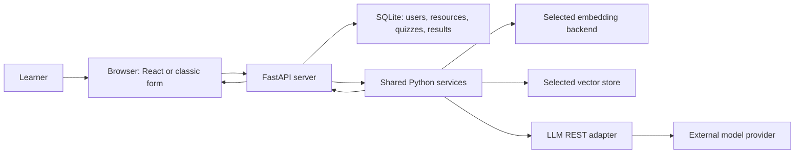
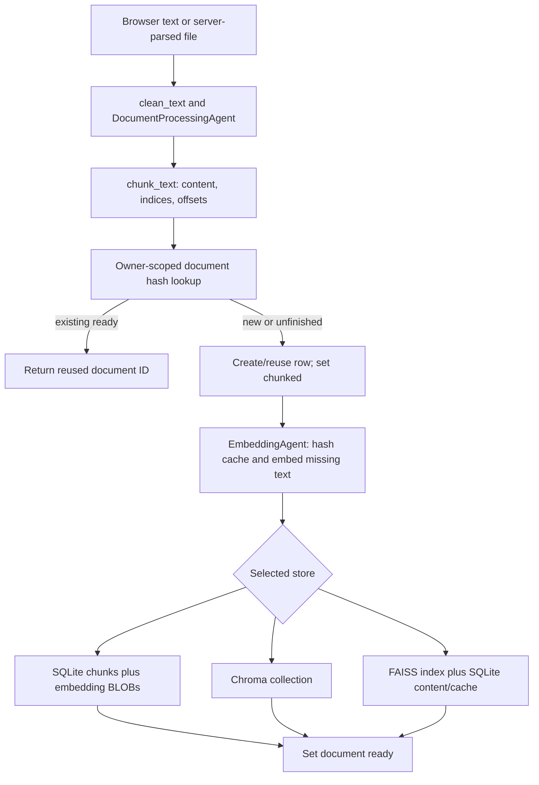
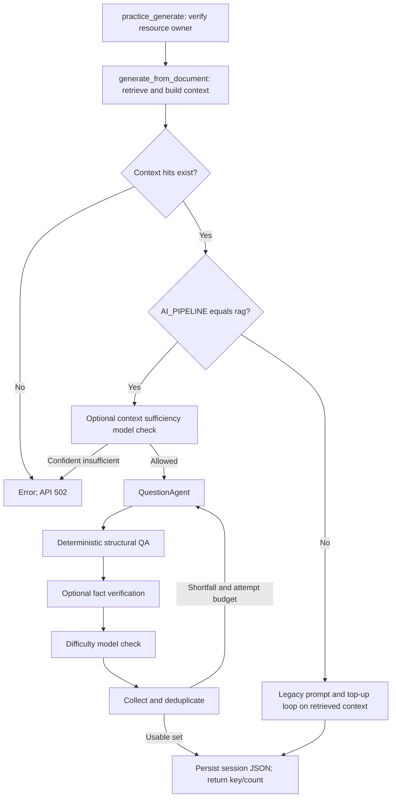
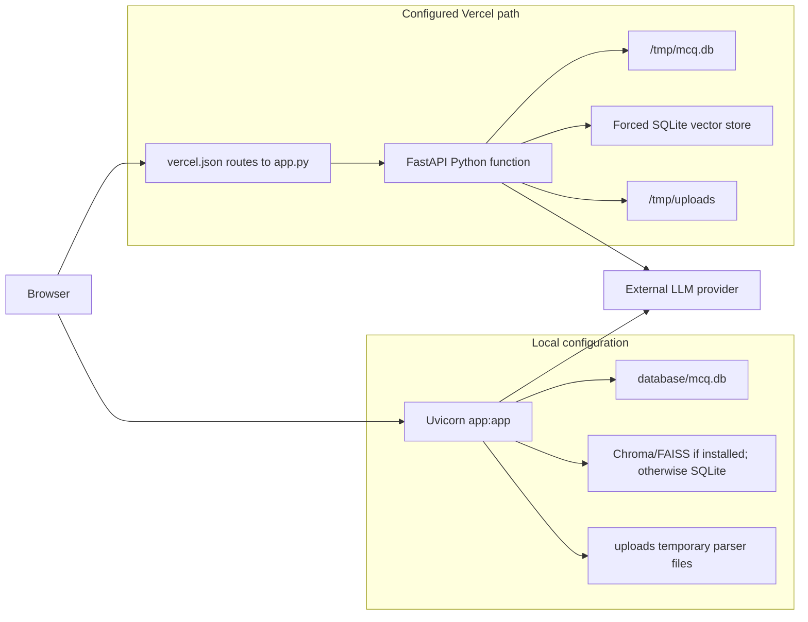
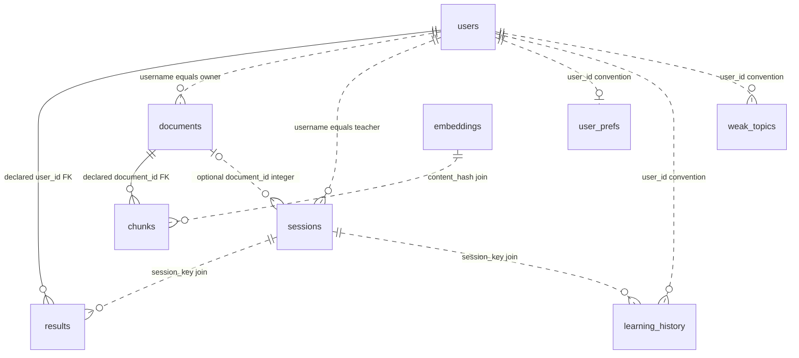

# MCQ Generator / Examly — Complete Engineering Explanation

Repository: https://github.com/dinu-vishruth/mcq  
Source baseline: `a906dfbe7fcf66cbff92ee8d56892948f0880c8d`, inspected on 14 October 2026.

This guide describes the current implementation. The working tree also contains an existing local change to `core/routes/documents.py`; that module belongs to the inactive Flask implementation and does not control the running FastAPI application. No application code was changed to create this document.

**Evidence convention:** **Verified** means supported by executable source or configuration, not necessarily proven in a live deployment. **Inferred** identifies a plausible engineering interpretation or consequence. **Not verified from the current codebase** identifies an unanswered runtime, historical, or quality question. Implementation paragraphs and tables under a **Verified** introduction inherit that status unless explicitly labeled otherwise. Source links use repository-relative paths; `#L...` records the inspected line, and named symbols remain useful if lines later move. Examples are illustrative inputs, not private documents or actual provider responses.

The application was inspected through its entry points, all active routers, frontend screens and template contracts, services, agents, prompt builders, persistence, parsing, retrieval, provider adapters, tests, and build/deployment configuration. Prior test/build observations from this engineering session are identified separately in section 18. No live provider/OAuth/deployment test was performed for this documentation task.

## Contents

1. [Project Overview](#1-project-overview)
2. [Problem Statement and Design Goals](#2-problem-statement-and-design-goals)
3. [Feature-by-Feature User Guide](#3-feature-by-feature-user-guide)
4. [Technology Stack and Responsibilities](#4-technology-stack-and-responsibilities)
5. [Repository Structure and File-by-File Guide](#5-repository-structure-and-file-by-file-guide)
6. [System Architecture](#6-system-architecture)
7. [End-to-End Data Flow](#7-end-to-end-data-flow)
8. [Document Processing and Ingestion](#8-document-processing-and-ingestion)
9. [Embeddings, Vector Stores, and Retrieval](#9-embeddings-vector-stores-and-retrieval)
10. [MCQ Generation: Internal Implementation](#10-mcq-generation-internal-implementation)
11. [Prompt Engineering and Context Engineering](#11-prompt-engineering-and-context-engineering)
12. [LLM Validation, Reliability, and Quality Control](#12-llm-validation-reliability-and-quality-control)
13. [Data Models, Persistence, and User Isolation](#13-data-models-persistence-and-user-isolation)
14. [Backend APIs and Frontend Integration](#14-backend-apis-and-frontend-integration)
15. [Security, Privacy, and Failure Handling](#15-security-privacy-and-failure-handling)
16. [Deployment and Environment Configuration](#16-deployment-and-environment-configuration)
17. [Performance, Cost, and Scalability](#17-performance-cost-and-scalability)
18. [Testing and Debugging Guide](#18-testing-and-debugging-guide)
19. [Design Decisions and Trade-Offs](#19-design-decisions-and-trade-offs)
20. [Known Limitations and Improvement Roadmap](#20-known-limitations-and-improvement-roadmap)
21. [Interview Preparation Guide](#21-interview-preparation-guide)
22. [Glossary and Learning Path](#22-glossary-and-learning-path)
23. [Final System Summary](#23-final-system-summary)

# 1. Project Overview

## 1.1 What the project is

**Verified:** the project is an AI-assisted study application whose current interface is branded **Examly**. It turns uploaded study material into multiple-choice questions, lets an authenticated user take quizzes, stores scores, and identifies frequently missed topics. The repository and several page titles still use “MCQ Generator.” MCQ means *multiple-choice question*: a question with several options and a designated correct answer. Evidence: [application title](fastapi_app/main.py#L64), [navigation brand](frontend/src/components/AppShell.tsx), [question contract](core/prompts/mcq.py#L12).

An **LLM**, or large language model, is an external text-generating model that the backend asks to create questions or explain mistakes. A **provider** is the service hosting that model. The application contains adapters for several providers; it does not train or host the production question-generating LLM itself. Evidence: [provider construction](core/llm/registry.py#L98), [generation entry point](models/mcq_generator.py#L54).

**Retrieval-augmented generation (RAG)** means finding useful passages in a saved resource and supplying them to the model as evidence. This application uses retrieval for saved-resource quiz generation even in its lighter legacy mode. The flag `AI_PIPELINE=rag` enables additional model-based validation stages. That distinction is central to understanding this repository. Evidence: [generate_from_document()](core/services/mcq_pipeline.py#L160).

## 1.2 Problem, audience, and use cases

**Inferred product purpose:** learners often have notes, textbook chapters, or slides but lack enough practice questions tailored to that material. Manually writing questions, plausible incorrect options, and explanations takes time. Reusing a resource and reviewing actual mistakes can make practice more convenient.

**Verified product support:** onboarding offers college exams, placement, interviews, competitive exams, certifications, and personal learning as goals. The active signup flow creates a unified user account; it does not enforce separate teacher and student capabilities, despite legacy database terminology. Evidence: [onboarding choices](frontend/src/screens/Onboarding.tsx#L11), [signup()](fastapi_app/routers/auth.py#L45).


Typical use cases are generating a quiz from a database chapter, practicing a technical concept before an interview, checking recall of lecture slides, and replaying questions previously missed. The backend also retains quiz-owner reporting and editing routes that may support tutor workflows. A complete classroom/invitation product is not implemented.

## 1.3 Verified capabilities and boundaries

| Capability | What exists today | Principal evidence |
|---|---|---|
| Accounts | Password signup/login, lockout, Google sign-in when configured, profile changes, logout, deletion | `fastapi_app/routers/auth.py`, `google_auth.py` |
| Material ingestion | PDF, DOCX, PPTX, TXT, or directly posted extracted text | `fastapi_app/routers/documents.py`, `models/pdf_processor.py` |
| Resource library | Owner-filtered listing, content deduplication, indexing state, deletion | `core/repositories/document_repo.py`, `Journey.tsx` |
| Configurable quizzes | Resource, difficulty, count, topic focus, duration | `MakeQuiz.tsx`, `PracticeIn`, `practice_generate()` |
| AI generation | Retrieved-context legacy generation or fuller RAG validation | `core/services/mcq_pipeline.py` |
| Quiz taking | Shuffled option order, browser timer, one question at a time | `student.mcq_test()`, `Quiz.tsx` |
| Results | Exact selected-text scoring, per-question review, optional explanations | `student.submit()`, `Result.tsx`, `ExplanationAgent` |
| Learning tracking | Topic labeling, cumulative weak-topic statistics, original-question review | `EvaluationAgent`, `learning_repo.py` |
| Progress | History-derived charts, study-time totals, XP, streaks, badges | `dashboard.py`, `Progress.tsx`, `prefs_repo.py` |
| Exports | Account/learning JSON, owner-only result CSV, quiz PDF | `api.export_data()`, `teacher.py` |

Flashcards, summaries, interview/coding content, revision notes, and short-answer evaluation have service or agent implementations, but no active route/screen connects them into complete user features. Chat history has a table; a working chat feature is not established. See sections 5, 11, and 13.

## 1.4 A real-world example

Consider a learner with a PDF about database transactions. They sign in, upload it, and reach quiz setup after ingestion. They select ten medium questions, optionally focus on deadlocks, and choose ten minutes. The backend retrieves passages from that resource, asks the configured model for questions, and stores the question set. The learner answers the quiz and sees a score and review. If topic labeling succeeds, missed concepts appear under Weak Topics and can be replayed from the saved questions.

This is an illustrative walkthrough of the implemented flow, not a claim about a particular model's actual generated questions. Evidence chain: [Upload.onSubmit()](frontend/src/screens/Upload.tsx#L52) → [documents.upload()](fastapi_app/routers/documents.py#L159) → [ingest_document()](core/services/ingestion_service.py#L22) → [MakeQuiz.generate()](frontend/src/screens/MakeQuiz.tsx#L58) → [practice_generate()](fastapi_app/routers/api.py#L264) → [generate_from_document()](core/services/mcq_pipeline.py#L160) → [submit()](fastapi_app/routers/student.py#L236).

**Nontechnical explanation:** “You give the application your study material. It helps turn that material into practice questions, checks your answers, and records the areas you should revisit. Its AI output still needs careful validation, and the current implementation has reliability and privacy gaps described later in this guide.”

# 2. Problem Statement and Design Goals

## 2.1 Manual and naive approaches

**Inferred:** a manual workflow requires reading the material, choosing useful concepts, writing unambiguous questions, constructing plausible distractors, grading answers, and maintaining a mistake log. A naive AI approach can send a whole document in one request and trust whatever text comes back. That risks oversized prompts, incomplete output, weak chapter coverage, incorrect answer keys, and hard-to-parse responses.

The repository addresses parts of that problem by cleaning/chunking content, retrieving a context subset, requesting structured JSON, validating questions, retrying shortfalls, and persisting performance. These are verified mechanisms, not proof that all generated questions are educationally sound.

## 2.2 Implemented requirements versus inferred goals

| Requirement or goal | Status | Mechanism and evidence | Remaining gap |
|---|---|---|---|
| Accept common study-document formats | Verified | Browser extractors and `extract_upload_text()` | No OCR; file fallback UI issue |
| Reuse saved material | Verified | `ingest_document()`, document library, resource-based generation | Original files are not retained as a document archive |
| Respect quiz settings | Verified | Pydantic `PracticeIn` and `MakeQuiz.generate()` | Edited-session duration uses a different range |
| Keep usable output during provider problems | Verified design | JSON salvage, retry, optional-check fail-open behavior | Can silently lower quality or return fewer questions |
| Separate provider-specific code | Verified design | `LLMProvider` and registry/adapters | Credential/model selection is inconsistent in some modes |
| Keep progress per user | Verified mechanism | `results.user_id`, topic and preference queries | Resource/session ownership uses mutable usernames |
| Reduce indexing work | Verified design | Document dedup and embedding cache | Cache ignores model identity; Chroma persistence differs |
| Fast feedback and responsive UI | Inferred goal, mechanisms verified | Bootstrap data, lazy screens, background indexing | Blocking calls, artificial progress, nondurable background work |
| Safe public multi-user operation | Inferred necessary requirement | Auth, CSRF, ownership guards | Confirmed structural identity/deletion/answer-exposure gaps |
| Durable hosted learning history | Inferred necessary requirement | SQLite storage paths | `/tmp` is temporary on Vercel |

Sources: [PracticeIn](fastapi_app/routers/api.py#L40), [LLMProvider](core/llm/base.py#L32), [ingestion](core/services/ingestion_service.py#L22), [middleware](fastapi_app/middleware.py#L39), [dashboard read model](fastapi_app/services/dashboard.py#L84), [configuration](config.py#L85).

## 2.3 Nonfunctional concerns

**Reliability:** quiz scoring is deterministic, but optional AI explanations execute before the result is saved. Ingestion uses several commits and can leave a resource in `chunked`. **Privacy:** queries are scoped, but the owner identity is unstable. **Latency:** repeated sequential LLM calls can dominate a request. **Maintainability:** interfaces and services help, while duplicate inactive routes and outdated comments create ambiguity. **Scalability:** document-scoped vector search reduces search scope, but SQLite writes, full result-history reads, re-embedding candidates, and synchronous network calls limit concurrency.

Evidence: [submit()](fastapi_app/routers/student.py#L236), [ingest_document()](core/services/ingestion_service.py#L46), [get_db()](core/models/db.py#L17), [Retriever.retrieve()](core/rag/retrieval/retriever.py#L55). Consequences and possible improvements are engineering inferences discussed in sections 17–20.

# 3. Feature-by-Feature User Guide

The following workflows are **Verified** in the active application unless a boundary is explicitly stated. JSON API details are consolidated in section 14; the call-by-call walkthroughs are in section 7.

## 3.1 Signup, login, Google sign-in, and logout

**What and why:** accounts associate results/preferences and uploaded resources with a learner. **Input:** signup/login forms provide username and password. Signup trims both values, requires nonempty fields and at least eight password characters, hashes the password, inserts a `student` role to satisfy the old schema, and redirects to login. The backend signup handler does not consume extra email/confirmation fields that may appear in a form or script.

Login counts failed attempts in the last five minutes where IP **or** username matches. At five failures it renders a lockout message. Otherwise it verifies the hash, records success/failure, and on success sets `user_id` and `username` in a signed session cookie. Output is an error page with HTTP 200 or a 302 dashboard redirect. Logout clears this cookie session through a GET route.

Google sign-in uses an authorization-code exchange: `/auth/google` saves a random state and redirects to Google; the callback consumes and compares state, exchanges the returned code server-side with `httpx.AsyncClient`, fetches user info, requires `email_verified`, then matches or creates an account. It matches `google_id` first, then email. API tokens are not stored in the application database by this flow. Failures render the login page; cancellation redirects home.

Frontend/source: [login template](templates/login.html), [signup template](templates/signup.html), [auth interactions](static/js/auth.js), [auth handlers](fastapi_app/routers/auth.py#L45), [Google handlers](fastapi_app/routers/google_auth.py#L63). Important limitations: no verified local email ownership, no reauthentication for sensitive profile actions, and the email-linking rule is unsafe; see section 15.

## 3.2 First-use onboarding and learning preferences

**Purpose:** collect the goal, preferred study style, and daily study minutes. `Dashboard` shows `Onboarding` when `needs_onboarding` is true. The user selects a goal/style/time or skips. `finish()`/`skip()` post JSON to `/api/prefs`; the backend validates lengths and a 5–600-minute bound, inserts/updates the row, sets `onboarded=1`, and returns `{ok:true}`. Output is dismissal of the overlay; preferences later influence dashboard text.

These preferences are not an adaptive syllabus or a scheduler. Settings uses the same API. The raw `fetch` callers do not check `response.ok`, so a failed HTTP response can still dismiss onboarding or display Saved. Evidence: [Onboarding.finish()/skip()](frontend/src/screens/Onboarding.tsx#L37), [Settings.savePrefs()](frontend/src/screens/Settings.tsx#L49), [save_prefs()](fastapi_app/routers/api.py#L60).

## 3.3 Upload material to make a quiz

**Purpose:** accept new material and prepare it for a configurable quiz. **Input:** a PDF/DOCX/TXT/PPTX file. The browser validates size, tries local text extraction for PDF/DOCX/TXT, samples long text, and posts `extracted_text` or the file through a multipart form. The server prefers nonblank extracted text, otherwise checks file size/extension and parses it. It cleans text, ingests/indexes synchronously, and redirects to `/knowledge?doc=<id>`.

**Output:** Make Quiz & Test with the resource preselected from the query string. Upload does **not** generate a quiz in its current handler. Empty, unsupported, corrupted or oversized server files render `upload.html` with an error. Browser extraction failure tries the server path if size permits, but the file input unmounting problem can break that fallback. Files sent as extracted text lose filename/source extension metadata unless separately supplied; this screen does not submit a title.

Sources: [Upload.pickFile()/onSubmit()](frontend/src/screens/Upload.tsx#L41), [extraction helpers](frontend/src/lib/extract.ts#L51), [documents.upload()](fastapi_app/routers/documents.py#L159), [extract_upload_text()](fastapi_app/routers/documents.py#L50).

## 3.4 Add a resource without making a quiz

**Purpose:** build a library for later practice. **Input:** file plus editable resource title. `AddResource` defaults title from the filename and posts to `/ingest_resource`. Extraction occurs before a daemon ingestion thread is started. The route immediately redirects to `/journey`; the thread calls `ingest_document()` and prints failures.

**Output:** the library page, potentially before the new resource exists or indexing finishes. This is best-effort in-process background work, not a queue or guaranteed saved job. The UI's animated steps are timer-driven and do not receive backend progress. Sources: [AddResource.onSubmit()](frontend/src/screens/AddResource.tsx#L51), [ingest_resource()](fastapi_app/routers/documents.py#L116), [Journey](frontend/src/screens/Journey.tsx#L16).

## 3.5 Browse, reuse, and remove library resources

`Journey` fetches `/api/knowledge` once and displays title, source-type label, ready/status state, apparent topic count, and estimated study time. `topic_count` is actually chunk count; the estimate is `max(5, round(chunks*1.5))`, not measured reading time. A practice link opens `/practice?doc=<id>`. Remove asks for confirmation, sends DELETE, then filters the item from local state.

The backend filters documents by current username. Deletion verifies that username against the document owner, deletes chunks and the document, and leaves the shared embedding cache. It does not call external-index deletion. Errors can appear as an empty library because initial fetch failures are converted to `[]`; there is no pending-job polling.

Sources: [Journey.remove()](frontend/src/screens/Journey.tsx#L28), [knowledge_list()/knowledge_delete()](fastapi_app/routers/api.py#L135), [list_by_owner()/delete()](core/repositories/document_repo.py#L91).

## 3.6 Configure and generate a quiz

**Input:** a ready resource, easy/medium/hard, question count, optional focus topic, and duration. UI count buttons offer 5/10/15/20/25/30; the API allows 1–30. UI duration buttons offer 5/10/20/30/60 minutes; the API accepts 30–10,800 seconds. `MakeQuiz` sends minutes multiplied by 60. Its defaults are ten medium questions and ten minutes, whereas API count default is five.

The API checks the document exists and belongs to the username, retrieves context, runs the configured generation mode, then stores a session with a UUID-prefix key. It returns `{ok,session_key,count}`. The UI creates and submits a classic `/student_login` form to enter the quiz. It currently ignores the returned delivered count. Missing/foreign resources return 404; invalid bodies return 422; generation failures return 502 and appear as an inline error when `apiSend` can parse them.

Sources: [MakeQuiz.generate()](frontend/src/screens/MakeQuiz.tsx#L58), [PracticeIn](fastapi_app/routers/api.py#L40), [practice_generate()](fastapi_app/routers/api.py#L264), [session repository](core/repositories/session_repo.py#L15).

## 3.7 Join and answer a quiz

The backend supports joining by an alphanumeric existing session key. Any authenticated user with the key can join; owner permission is not required to take it. The current React navigation automatically joins newly generated/review quizzes; a dedicated working join-by-key UI is not established by the active Dashboard screen. `GET /student_login` renders the dashboard shell rather than a distinct join form.

The server loads MCQs, shuffles **options only**, and relabels them A–D. Question order remains unchanged. React stores selected option text by question index, displays one question at a time, allows Previous, and requires selection before Next. Confidence choices are local state only. A browser countdown auto-submits at zero. The hidden form sends selected texts, display name, CSRF token, and elapsed time to `/submit`.

Important cases: no joined key redirects; a prior result blocks another attempt; refresh loses answer state and resets the timer; opening another quiz in a second tab replaces the single session-cookie quiz key. Correct answers are present in the page bootstrap even though the UI does not display them. Sources: [student_login()](fastapi_app/routers/student.py#L175), [mcq_test()](fastapi_app/routers/student.py#L204), [Quiz.choose()/submit()](frontend/src/screens/Quiz.tsx#L57), [quiz template](templates/mcq_test.html#L21).

## 3.8 Results and explanations

The backend compares each submitted option text exactly with the stored correct text, builds `{question,selected,correct,is_correct}` detail records, and totals correct answers. It asks `ExplanationAgent` for explanations **before** persisting the result. It then inserts the score/detail/time row, attempts topic analysis and XP/streak updates, and renders `result.html` directly as the POST response.

The user sees an animated percentage ring, correct/to-review totals, per-question answer review, and explanations. Confetti appears at 80%+. The “AI Insight” paragraph is selected from fixed frontend text using score thresholds; it is not another model response. AI explanations cover wrong **answered** questions when a unified LLM key is set; correct/unanswered items receive fixed messages. The live submission path does not supply document context to explanations. Explanations themselves are not persisted in `results.detail_json`.

Sources: [submit()](fastapi_app/routers/student.py#L236), [explain_answers()](models/explanation_engine.py#L15), [ExplanationAgent.run()](core/agents/explanation.py#L23), [Result](frontend/src/screens/Result.tsx#L84), [result shell](templates/result.html#L19). There is no active GET endpoint to reopen the full learner result page by result ID.

## 3.9 Weak topics and replaying mistakes

After submission, `EvaluationAgent` sends question texts for short topic labels, falls back to General when labeling fails, and records per-question events plus cumulative wrong/total counts. Weak Topics shows highest miss-rate topics, severity, and reconstructable missed-question counts.

Review provides a topic string. The repository finds that user's historical wrong questions, locates their original session JSON, matches question text, deduplicates, and returns up to twenty MCQs. The route creates a new `review` session with about 45 seconds per question, clamped to 60–1,800 seconds. No LLM is needed to **create** this review quiz; taking/submitting it can still invoke normal explanation/topic-analysis calls.

Deleted or edited source sessions can make questions unreconstructable. A later correct answer does not erase the historical wrong event, so the review list is not a current due-for-review or mastered-question model. Sources: [EvaluationAgent.run()](core/agents/evaluation.py#L23), [missed_questions_for_topic()](core/repositories/learning_repo.py#L63), [weak_topics_review()](fastapi_app/routers/api.py#L194), [WeakTopics.review()](frontend/src/screens/WeakTopics.tsx#L36).

## 3.10 Dashboard, progress, XP, streaks, and achievements

The dashboard server aggregates result history, document count, weak topics and preferences into bootstrap JSON. It provides average quiz percentage, recent results, chart points and rule-based study recommendations. React only fetches `/api/dashboard` if it considers bootstrap data absent. A displayed revision reminder is based on the weakest topic; there is no spaced-review scheduling calculation.

Progress calculates question-weighted accuracy, time totals, daily counts, and **monthly** average percentages, although the payload field is named `weekly`. The frontend builds a 17-week heatmap. Topic “mastery” is displayed as `100 - miss_percentage`, not a learning-estimation model.

Submission awards `10 * correct + 5` XP. `record_activity()` increments the streak on consecutive server-local calendar days, keeps it for same-day activity, and resets to one after a gap. Level is `xp // 100 + 1`. Achievements derives badges from results/streak/XP on demand. Its rules differ from hardcoded Progress badges; the selection-time “+10 XP” animation is not actual awarded XP.

Sources: [build_dashboard()](fastapi_app/services/dashboard.py#L84), [progress()](fastapi_app/routers/student.py#L61), [Progress](frontend/src/screens/Progress.tsx#L48), [record_activity()](core/repositories/prefs_repo.py#L59), [achievements_data()](fastapi_app/routers/api.py#L224). Fetch failure on Achievements leaves a null payload and can display an endless spinner.

## 3.11 Profile, account deletion, and JSON export

Settings lets a user update username/email and optionally password, update preferences, export learning data, and delete the account. Username uniqueness and password minimum length are checked; email ownership is not verified. Profile success queues a flash and redirects home. Changing username does not update document/session ownership.

Export downloads account metadata, preferences, result summaries, weak-topic counts and an export timestamp. It does not export source content, MCQ sets, detailed answers, explanations, or full learning history. Delete removes owned sessions/results and selected user-ID learning/preference rows, then the user; documents/chunks/chat/external indexes are not removed.

Sources: [Settings](frontend/src/screens/Settings.tsx#L22), [profile()/delete_account()](fastapi_app/routers/auth.py#L131), [export_data()](fastapi_app/routers/api.py#L98). Sensitive actions are CSRF-protected but do not require the old password or fresh authentication.

## 3.12 Less-visible session-owner tools

Authenticated owners can request a session report, export result CSV, download a PDF question set, edit quiz text/options/answer/timer/difficulty, clone it, archive/unarchive it, or delete it. `owned_session()` centralizes the username check. These handlers are active even though the modern Dashboard does not expose all management actions from the legacy teacher dashboard.

The report joins result rows with registered usernames and sorts by score. PDF writes questions/options to `reports/report_<key>.pdf`; it does **not** render an answer-key section. CSV streams name, username, score, total, percentage, time and submission date. Edit accepts nonempty text/options and an answer matching text or a label, with a 10–3,600-second duration. It does not reject duplicate option text or preserve optional RAG metadata. Clone copies the set into a new unarchived session and omits document linkage. Archive does not prevent the joining/taking routes from loading the session. Delete removes sessions/results but leaves learning aggregates/history.

Sources: [owned_session()](fastapi_app/routers/teacher.py#L44), [download_report()](fastapi_app/routers/teacher.py#L89), [edit_session()](fastapi_app/routers/teacher.py#L198), [export_results()](fastapi_app/routers/teacher.py#L257), [legacy dashboard template](templates/teacher_dashboard.html).

# 4. Technology Stack and Responsibilities

**Verified dependencies:** Python packages in [requirements.txt](requirements.txt) have no pinned versions. Frontend [package.json](frontend/package.json) declares ranges; [package-lock.json](frontend/package-lock.json) records resolved packages. Some libraries used by FastAPI, including Starlette and Pydantic, are transitive dependencies rather than explicit requirement entries. PDF.js/Mammoth are vendored browser scripts, not frontend npm dependencies. The following benefits/alternatives are **Inferred engineering comparisons**, while usage locations are verified.

| Technology/library | Repository use and exact responsibility | Why useful here | Alternative and trade-off |
|---|---|---|---|
| Python | Backend, parsers, services, repositories, agents | Mature document/AI tooling | TypeScript/Java backend; different ecosystem and rewrite cost |
| FastAPI | `fastapi_app/main.py`, routers; HTTP routing/dependencies/body validation | Explicit route contracts and ASGI support | Flask or Django; current async handlers still call blocking helpers |
| Uvicorn | `app.py`, `Procfile`; ASGI server | Runs FastAPI locally/hosted | Other ASGI servers; host/worker settings still need tuning |
| Starlette/itsdangerous | Session middleware and tests; signed cookie payloads | Avoids per-instance session files | Revocable server sessions; requires durable/shared session storage |
| Pydantic | `PrefsIn`, `ReviewIn`, `PracticeIn`; JSON body validation | Rejects invalid ranges and difficulties | Manual/schema validation; current LLM outputs do not use Pydantic |
| python-multipart | FastAPI forms/upload parsing | Supports existing multipart form contract | Direct object uploads; needs storage integration |
| Jinja2 | `templating.py`, `templates/`; HTML and JSON bootstrap rendering | Keeps routes/auth server-owned | Full SPA or another template system; islands duplicate shell contracts |
| Werkzeug | `auth.py`, database seed; password hashes/checks | Established hash interface and migration compatibility | Another password-hash library; costs/algorithms need explicit policy |
| SQLite / sqlite3 | `core/models/db.py`; relational users/resources/results storage | No separate local database service | Durable PostgreSQL or another shared database; migrations and operations increase |
| NumPy | SQLite vector search and MMR; matrices, float32 BLOB conversion | Compact vector math | Pure Python slower search or vector service with operational overhead |
| requests | LLM adapters and remote embeddings; synchronous HTTP | Simple REST integration without vendor SDK | `httpx.AsyncClient`; requires async service propagation |
| httpx | Google exchange and FastAPI test client | Async OAuth network calls and in-process tests | OAuth SDK; more abstraction/dependencies |
| python-dotenv | `config.py`; root `.env` loading | Local configuration convenience | Real environment injection only; easier to miss local setup |
| pdfplumber | `pdf_processor.py`; PDF text and table extraction | Extracts text-based educational PDFs | Another PDF parser or OCR; quality/performance differ |
| python-docx | DOCX paragraphs/tables | Understands Word structure | Another parser/conversion service; format coverage varies |
| python-pptx | PPTX text/table/group/notes extraction | Reads lecture-slide content | PDF conversion or other slide parser; loses some source semantics |
| ReportLab | Owner quiz PDF download | Programmatic PDF output | HTML-to-PDF/layout engine; current manual wrapping is limited |
| React / React DOM | `main.tsx`, screens; interactive rendering/hooks | Component reuse and local state | Server-only templates, Vue, etc.; React screens need JavaScript |
| TypeScript | `frontend/src`; compile-time interfaces | Helps catch UI type errors | JavaScript; neither supplies runtime response validation alone |
| Vite | `vite.config.ts`; bundling/lazy chunks | Builds static assets for Python serving | Other bundlers; stable filenames need cache policy |
| Tailwind / PostCSS / Autoprefixer | styling tokens and CSS build | Consistent reusable visual classes | Plain CSS or another styling system; build step required |
| Framer Motion | screens/components; transitions/confetti/progress | Interactive feedback | CSS animation; animation code adds JS and can distract |
| lucide-react | icons | Shared vector icon vocabulary | Another icon set/custom SVG; not application logic |
| Recharts | `TrendChart.tsx`; dashboard visualization | React chart integration | Another chart library/custom chart; bundle and accessibility trade-offs |
| PDF.js | `static/js/pdf.min.js`, browser extract helper | Parses PDF text before upload | Server parser; larger request payloads |
| Mammoth | vendored script, DOCX extraction | Browser raw-text extraction | Server python-docx; different extraction fidelity |
| SentenceTransformers / torch, optional | `sentence_transformer.py`; neural text vectors | Semantic embedding path on capable hosts | Hashing or remote API; package/model size and startup cost |
| ChromaDB, optional | `ChromaStore`; persistent per-document vector collections | Indexed vector retrieval | SQLite/FAISS; additional dependency and different persistence contract |
| FAISS, optional | `FaissStore`; exact `IndexFlatIP` vector index | Optimized inner-product search | Approximate index or vector database; current index is not approximate |
| Groq/xAI/OpenAI/Gemini/Anthropic; Together branch | `core/llm`; externally hosted model calls | Can change model host through adapters | Local inference; requires runtime/model integration and capacity |
| Vercel | `vercel.json`, environment branches | Python function deployment target | Persistent host/container; different storage and operational responsibilities |
| unittest / TestClient | `tests/`; deterministic unit/in-process HTTP tests | No paid AI required for most tests | pytest/browser tests; current suite has global mutation/isolation gaps |

The lockfile resolves React/React DOM 18.3.1, Vite 5.4.21, TypeScript 5.9.3, Tailwind 3.4.19, Framer Motion 11.18.2, Recharts 2.15.4, and lucide-react 0.417.0. These are repository lockfile values, not promises of live installed versions or current security status.

A **framework** organizes code and HTTP execution (FastAPI/React). A **database** stores relational records (SQLite). A **vector store** indexes or stores numeric text representations (SQLite+NumPy, Chroma, FAISS). A **model** computes embeddings or generated text. A **provider** hosts a model/API. A **deployment platform** runs the application. These roles remain distinct even when a single vendor supplies several.

# 5. Repository Structure and File-by-File Guide

## 5.1 Relevant source tree

**Verified:** this expanded tree covers application source and configuration. Empty package markers, lockfile contents, generated chunks, dependencies, private environments, caches, databases, uploaded material and local reports are collapsed deliberately.

```text
mcq/
├── app.py
├── config.py
├── README.md
├── requirements.txt
├── Procfile
├── vercel.json
├── .gitignore
├── .vercelignore
├── .env.example
├── database/schema.sql
├── fastapi_app/
│   ├── main.py
│   ├── database.py
│   ├── deps.py
│   ├── security.py
│   ├── middleware.py
│   ├── templating.py
│   ├── uploads.py
│   ├── routers/
│   │   ├── auth.py
│   │   ├── google_auth.py
│   │   ├── documents.py
│   │   ├── student.py
│   │   ├── teacher.py
│   │   └── api.py
│   └── services/dashboard.py
├── core/
│   ├── services/
│   │   ├── ingestion_service.py
│   │   ├── mcq_pipeline.py
│   │   ├── learning_service.py
│   │   └── content_service.py
│   ├── repositories/
│   │   ├── document_repo.py
│   │   ├── session_repo.py
│   │   ├── learning_repo.py
│   │   └── prefs_repo.py
│   ├── models/
│   │   ├── db.py
│   │   └── migrations.py
│   ├── rag/
│   │   ├── chunker.py
│   │   └── retrieval/retriever.py
│   ├── agents/
│   │   ├── base.py
│   │   ├── document_processing.py
│   │   ├── embedding.py
│   │   ├── retriever.py
│   │   ├── context_builder.py
│   │   ├── context_validation.py
│   │   ├── planner.py
│   │   ├── question.py
│   │   ├── quality_assurance.py
│   │   ├── fact_verification.py
│   │   ├── difficulty.py
│   │   ├── explanation.py
│   │   ├── evaluation.py
│   │   ├── revision.py
│   │   └── answer_evaluation.py
│   ├── prompts/
│   │   ├── mcq.py
│   │   ├── planner.py
│   │   ├── context_validation.py
│   │   ├── fact_verification.py
│   │   ├── difficulty.py
│   │   ├── explanation.py
│   │   ├── evaluation.py
│   │   ├── revision.py
│   │   ├── answer_evaluation.py
│   │   ├── content.py
│   │   └── qa.py
│   ├── llm/
│   │   ├── base.py
│   │   ├── registry.py
│   │   ├── openai_compatible.py
│   │   ├── gemini.py
│   │   └── anthropic.py
│   ├── embeddings/
│   │   ├── base.py
│   │   ├── registry.py
│   │   ├── hashing.py
│   │   ├── sentence_transformer.py
│   │   └── remote_api.py
│   ├── vectorstore/
│   │   ├── base.py
│   │   ├── registry.py
│   │   ├── sqlite_numpy.py
│   │   ├── chroma_store.py
│   │   └── faiss_store.py
│   └── routes/              # inactive Flask implementation
│       ├── __init__.py
│       ├── auth.py
│       ├── student.py
│       ├── teacher.py
│       ├── documents.py
│       └── api.py
├── models/
│   ├── pdf_processor.py
│   ├── mcq_generator.py
│   └── explanation_engine.py
├── utils/
│   ├── text_cleaner.py
│   ├── session_manager.py
│   └── difficulty_classifier.py
├── frontend/
│   ├── package.json
│   ├── package-lock.json
│   ├── vite.config.ts
│   ├── tsconfig.json
│   ├── tailwind.config.js
│   ├── postcss.config.js
│   └── src/
│       ├── main.tsx
│       ├── bootstrap.ts
│       ├── types.ts
│       ├── index.css
│       ├── lib/{extract.ts,cn.ts}
│       ├── components/
│       │   ├── AppShell.tsx
│       │   ├── charts/TrendChart.tsx
│       │   └── ui/{Button,Card,Badge,StatCard,ProgressBar}.tsx
│       └── screens/
│           ├── Dashboard.tsx
│           ├── Onboarding.tsx
│           ├── Upload.tsx
│           ├── AddResource.tsx
│           ├── Journey.tsx
│           ├── MakeQuiz.tsx
│           ├── Quiz.tsx
│           ├── Result.tsx
│           ├── Progress.tsx
│           ├── WeakTopics.tsx
│           ├── Achievements.tsx
│           └── Settings.tsx
├── templates/
│   ├── login.html
│   ├── signup.html
│   ├── student_dashboard.html
│   ├── upload.html
│   ├── add_resource.html
│   ├── journey.html
│   ├── knowledge.html
│   ├── practice.html
│   ├── mcq_test.html
│   ├── result.html
│   ├── progress.html
│   ├── weak_topics.html
│   ├── achievements.html
│   ├── profile.html
│   ├── session_report.html
│   ├── edit_session.html
│   ├── teacher_dashboard.html
│   └── partials/{shell.html,shell_end.html,icons.html}
├── static/
│   ├── dist/                # app.js, app.css, lazy generated chunks
│   ├── css/style.css
│   └── js/{auth.js,timer.js,pdf.min.js,pdf.worker.min.js,mammoth.browser.min.js}
├── tests/
│   ├── _client.py
│   ├── test_config_keys.py
│   ├── test_features.py
│   ├── test_regression.py
│   ├── test_rag.py
│   ├── test_pipeline.py
│   ├── test_verification.py
│   ├── test_llm_retry.py
│   ├── test_learning.py
│   └── test_content.py
├── train/{train_model.py,mcq_dataset.py}
├── download_pytorch_cuda.py
├── test_mcq.py
├── _repro_lib.py
└── _test_migration.py
```

## 5.2 Startup, HTTP, and infrastructure files

**Verified file roles:** each entry lists input → output and the main call relationship.

| File | Symbols, purpose, and call relationships |
|---|---|
| [app.py](app.py#L13) | Imports the module-level FastAPI `app`; executable mode invokes Uvicorn. Host request → active FastAPI app. It does not register Flask blueprints. |
| [config.py](config.py#L30) | `env_str()`, `llm_key_present()`, `missing_key_message()`, `mcq_token_budget()` and configuration constants. Environment/root `.env` → process settings consumed throughout services. |
| [fastapi_app/main.py](fastapi_app/main.py#L64) | `create_app()`, `_log_llm_config()`, redirect/API exception handlers. Initializes DB/uploads, middleware/static/routers; incoming HTTP → router response. |
| [fastapi_app/database.py](fastapi_app/database.py#L75) | `init_db()`, `_seed_demo_users()`. Called during app construction; schema file/base SQL → tables, additive columns, demo rows, RAG migrations. |
| [fastapi_app/deps.py](fastapi_app/deps.py#L42) | `User`, `RedirectException`, `require_user()`, `require_api_user()`, `db()`, annotated aliases. Cookie → lightweight user; yields/closes SQLite connection for handlers. |
| [fastapi_app/security.py](fastapi_app/security.py#L40) | Token minting, header/form lookup, constant-time comparison, HTML failure response. Called by templates/middleware; session/body → CSRF validity. |
| [fastapi_app/middleware.py](fastapi_app/middleware.py#L39) | `CSRFMiddleware`, `_replayer()`, `HTTPSRedirectOnVercelMiddleware`. Buffers/replays mutation bodies; session/token → rejection or downstream app. |
| [fastapi_app/templating.py](fastapi_app/templating.py#L55) | `render()`, `flash()`, `_get_flashed_messages()`, rooted Jinja environment. Route variables/session → HTML/bootstrap/CSRF metadata. |
| [fastapi_app/uploads.py](fastapi_app/uploads.py#L20) | `FileStorageAdapter`, `size_of()`. FastAPI upload → read/seek/save/stream interface expected by old document parsers. |
| [fastapi_app/routers/auth.py](fastapi_app/routers/auth.py) | Home/signup/login/logout/profile/delete handlers. Forms + user/DB → HTML or redirects; calls hash functions and inline SQL. |
| [fastapi_app/routers/google_auth.py](fastapi_app/routers/google_auth.py#L128) | `google_login()`, `google_callback()`, `_fetch_google_profile()`, `_upsert_google_user()`, `_unique_username()`, `_redirect_uri()`. OAuth code/profile → local user/session. |
| [fastapi_app/routers/documents.py](fastapi_app/routers/documents.py#L50) | `extract_upload_text()`, `upload()`, `ingest_resource()`, unused `_check_generation_throttle()`. Multipart → cleaned text → ingestion → HTML/redirect. |
| [fastapi_app/routers/student.py](fastapi_app/routers/student.py) | Page handlers, `_already_attempted()`, join/test/submit. Quiz cookie/answers → stored result, explanations, learning/XP; progress queries inline SQL. |
| [fastapi_app/routers/teacher.py](fastapi_app/routers/teacher.py#L44) | `owned_session()`, report/export/edit/lifecycle handlers, `_parse_edited_question()`. Owner/key/forms → session changes or PDF/CSV/HTML. |
| [fastapi_app/routers/api.py](fastapi_app/routers/api.py#L29) | `PrefsIn`, `ReviewIn`, `PracticeIn`; ten JSON endpoints. Validated body/user → services/repositories → JSON or explicit HTTP errors. |
| [fastapi_app/services/dashboard.py](fastapi_app/services/dashboard.py#L84) | `build_dashboard()`, `load_prefs()`, `level_for_xp()`, `study_recommendations()`. Result/pref/resource data → HTML/API shared dashboard payload. |
| [database/schema.sql](database/schema.sql) | Original users/sessions/results definitions; later columns/tables come from bootstrap/migrations, so this file alone is not the complete schema. |

## 5.3 Services, repositories, and utilities

| File | Main symbols and place in the call graph |
|---|---|
| [core/services/ingestion_service.py](core/services/ingestion_service.py#L22) | `ingest_document()` orchestrates processing/dedup/status/embed-store. Raw text + owner/title/type → document ID, reuse flag, counts/statistics. |
| [core/services/mcq_pipeline.py](core/services/mcq_pipeline.py#L160) | `generate_from_document()`, `generate_mcqs_rag()`, `_collect_mcqs()`, `_retrieval_query()`, `_legacy_from_context()`, `_legacy_fallback()`, `_max_attempts()`. Resource/text/options → retrieved context → generated MCQ list. |
| [core/services/learning_service.py](core/services/learning_service.py#L15) | `analyse_submission()`, `get_weak_topics()`, `get_recommendations()`. Submission → EvaluationAgent; dashboard/API reads → learning repo. Model recommendations helper is not used by active dashboard recommendation code. |
| [core/services/content_service.py](core/services/content_service.py#L36) | `Generator`, `GENERATORS`, `supported_intents()`, `generate_content()`. Intent/text → ingest/retrieve/prompt/JSON items; tested service, not active UI/API. |
| [core/repositories/document_repo.py](core/repositories/document_repo.py) | `doc_hash()`, `find_by_hash()`, `create()`, `set_status()`, `get()`, `get_chunks()`, `list_by_owner()`, `delete()`. Services/API → document/chunk SQL with independent connections. |
| [core/repositories/session_repo.py](core/repositories/session_repo.py#L15) | `create_session()`, `exists()`, `get()`. MCQ list → JSON session row/key; student routes load rows. Legacy insert fallback catches any exception from the first insert. |
| [core/repositories/learning_repo.py](core/repositories/learning_repo.py) | `record_events()`, `upsert_weak_topics()`, `missed_questions_for_topic()`, `top_weak_topics()`. Analysis/events → SQL; review → reconstructed MCQs from session JSON. |
| [core/repositories/prefs_repo.py](core/repositories/prefs_repo.py#L59) | `load()`, `_ensure_row()`, `save_onboarding()`, `record_activity()`. User prefs/XP gain → prefs row/streak/level-change state. Active preferences endpoint duplicates some SQL rather than calling `save_onboarding()`. |
| [core/models/db.py](core/models/db.py#L17) | `get_db()` returns a new sqlite3 Row connection using current `config.DB_PATH`; callers own closing/transactions. |
| [core/models/migrations.py](core/models/migrations.py#L197) | `run_migrations()`, schema constants, owner-scoped-dedup detection/rebuild. Existing connection → schema/index updates; special rebuild preserves surviving document IDs. |
| [models/pdf_processor.py](models/pdf_processor.py) | `extract_text_from_pdf/docx/pptx()` are called by upload extraction; uploaded file/path → flat text. |
| [models/mcq_generator.py](models/mcq_generator.py#L54) | Public `generate_mcqs()`, `MCQGenerationError`, legacy structure/extraction helpers. Text → provider/prompt/top-up → MCQs, or delegate to text-RAG mode. |
| [models/explanation_engine.py](models/explanation_engine.py#L15) | `explain_answers()` wrapper preserves the old API; submission details → `ExplanationAgent.run()` → aligned strings. |
| [utils/text_cleaner.py](utils/text_cleaner.py#L4) | `clean_text()` normalizes whitespace/removes controls; used by extraction, processing and generation. |
| [utils/session_manager.py](utils/session_manager.py#L12) | `create_session_key()`, `validate_session_key()` delegate to session repo; keeps legacy callers compatible. |
| [utils/difficulty_classifier.py](utils/difficulty_classifier.py#L2) | `classify_difficulty()` estimates by average words per period-separated sentence. It is not called by the current DifficultyAgent. |

## 5.4 Agent files

“Agent” here means a small named class performing a pipeline responsibility. It is not evidence of an autonomous agent framework, separate process, tool-using model, or multi-agent conversation.

| File/class | Called by; inputs → work → outputs |
|---|---|
| [base.py — Agent](core/agents/base.py#L5) | Parent class; `_log()` prints a named prefix. No shared LLM field is actually implemented. |
| [document_processing.py — DocumentProcessingAgent](core/agents/document_processing.py#L29) | Ingestion; text → clean/chunk/basic metadata → `ProcessedDocument`. Does not parse binary files itself. |
| [embedding.py — EmbeddingAgent](core/agents/embedding.py#L28) | Ingestion; Chunk list → hash-cache lookup/batch embedding/upsert → statistics. |
| [retriever.py — RetrieverAgent](core/agents/retriever.py#L26) | Pipelines/explanation/revision; doc/query/k → Retriever → SearchHits; `assess()` reports advisory similarities. |
| [context_builder.py — ContextBuilderAgent](core/agents/context_builder.py#L16) | Generation/explanation/revision; hits → positional character-limited blocks → context string. |
| [planner.py — PlannerAgent, Plan](core/agents/planner.py#L29) | Optional `user_request` in text-RAG; request → intent/count/difficulty/topic. Does not automatically dispatch content services. |
| [question.py — QuestionAgent](core/agents/question.py#L26) | Collector; context/count/difficulty → LLM JSON → raw MCQs or `InsufficientContextError`. |
| [quality_assurance.py — QualityAssuranceAgent](core/agents/quality_assurance.py#L24) | RAG collector; MCQs → deterministic structure/answer-membership checks → valid/rejected lists. |
| [context_validation.py — ContextValidationAgent](core/agents/context_validation.py#L24) | RAG entry points; context/count/level → LLM sufficiency check → effective sufficient/confidence/reason. |
| [fact_verification.py — FactVerificationAgent](core/agents/fact_verification.py#L27) | RAG collector; MCQs/context → batch LLM verification → retained/rejected questions. |
| [difficulty.py — DifficultyAgent](core/agents/difficulty.py#L20) | RAG collector; question text/requested level → LLM grades → matched/mismatched indices. |
| [explanation.py — ExplanationAgent](core/agents/explanation.py#L23) | Submission wrapper; wrong answers and optional doc → prompt → aligned teaching/static strings. |
| [evaluation.py — EvaluationAgent](core/agents/evaluation.py#L23) | Learning service; scored details → topic labels → events/stats persisted; `recommend()` supports separate AI tips. |
| [revision.py — RevisionAgent](core/agents/revision.py#L17) | Component only; topics/optional doc → optional retrieval → notes list; errors return empty. |
| [answer_evaluation.py — AnswerEvaluationAgent](core/agents/answer_evaluation.py#L32) | Component only; free answer/reference/context → conceptual score/feedback; retries once for low confidence and normalizes output. |

## 5.5 Retrieval, embeddings, providers, and prompts

| File | Main responsibility, callers, and data |
|---|---|
| [core/rag/chunker.py](core/rag/chunker.py#L69) | `Chunk`, `_segments()`, `chunk_text()`, `_window_sweep()`; document processor → text windows with offsets and estimated token counts. |
| [core/rag/retrieval/retriever.py](core/rag/retrieval/retriever.py#L55) | `Retriever.retrieve()`, `mmr_select()`; query/doc → embedding/store candidates → diverse hits. `_cosine_matrix()` is present but unused. |
| [core/embeddings/base.py](core/embeddings/base.py#L10) | Abstract `Embedder.embed_batch()` and single-text `embed()`; consumed by agents/retriever. |
| [core/embeddings/registry.py](core/embeddings/registry.py#L28) | `build_embedder()/get_embedder()/reset_embedder()`; config/import capability → cached backend. |
| [core/embeddings/hashing.py](core/embeddings/hashing.py#L23) | `HashingEmbedder`; lexical tokens → deterministic signed feature vector. |
| [core/embeddings/sentence_transformer.py](core/embeddings/sentence_transformer.py#L15) | `SentenceTransformerEmbedder`; configured local model → batched normalized vectors. |
| [core/embeddings/remote_api.py](core/embeddings/remote_api.py#L23) | `RemoteAPIEmbedder`, `_l2()`; OpenAI batch or Gemini per-text REST → normalized vectors. |
| [core/vectorstore/base.py](core/vectorstore/base.py#L15) | `SearchHit`, abstract `VectorStore`; common query/upsert/has/delete contracts. |
| [core/vectorstore/registry.py](core/vectorstore/registry.py#L19) | Build/get/reset store; embedding identity/config/environment → cached backend, with initialization fallbacks. |
| [core/vectorstore/sqlite_numpy.py](core/vectorstore/sqlite_numpy.py#L28) | `SqliteNumpyStore`; upserts SQL chunks/cache; query loads document vectors and ranks dot products. |
| [core/vectorstore/chroma_store.py](core/vectorstore/chroma_store.py#L17) | `ChromaStore`; per-document persistent collection upsert/query/delete, cosine scores. |
| [core/vectorstore/faiss_store.py](core/vectorstore/faiss_store.py#L20) | `FaissStore`; SQL content plus per-document exact inner-product index file. |
| [core/llm/base.py](core/llm/base.py#L32) | `LLMProvider`, `LLMError`, `RateLimitError`; retry template, JSON parsing, complete-object salvage. |
| [core/llm/registry.py](core/llm/registry.py#L98) | `_model_for()`, `_resolve_auto()`, build/get/reset LLM; credentials/config → cached provider. |
| [core/llm/openai_compatible.py](core/llm/openai_compatible.py#L25) | `OpenAICompatibleProvider`; shared chat-completions REST request and Groq failed-JSON recovery. |
| [core/llm/gemini.py](core/llm/gemini.py#L17) | `GeminiProvider`; maps messages to generateContent fields and response extraction. |
| [core/llm/anthropic.py](core/llm/anthropic.py#L20) | `AnthropicProvider`; Maps system/turns to Messages API; JSON instruction, no actual assistant prefill. |

The corresponding `__init__.py` files re-export interfaces and get/reset helpers. They do not introduce another runtime service.

| Prompt file | Builders and consumers |
|---|---|
| [mcq.py](core/prompts/mcq.py#L26) | `legacy_prompt()`, `rag_prompt()`, Bloom guidance; legacy generator/QuestionAgent |
| [context_validation.py](core/prompts/context_validation.py#L12) | `validate_prompt()`; ContextValidationAgent |
| [fact_verification.py](core/prompts/fact_verification.py#L12) | `verify_prompt()`; FactVerificationAgent |
| [difficulty.py](core/prompts/difficulty.py#L10) | `grade_prompt()`; DifficultyAgent |
| [explanation.py](core/prompts/explanation.py#L25) | `legacy_prompt()`, `grounded_prompt()`; ExplanationAgent |
| [evaluation.py](core/prompts/evaluation.py#L10) | `topic_label_prompt()`, `recommendation_prompt()`; EvaluationAgent |
| [planner.py](core/prompts/planner.py#L21) | `plan_prompt()`, intent taxonomy; PlannerAgent |
| [revision.py](core/prompts/revision.py#L9) | `revision_notes_prompt()`; RevisionAgent component |
| [answer_evaluation.py](core/prompts/answer_evaluation.py#L14) | `evaluate_prompt()`; short-answer component |
| [content.py](core/prompts/content.py) | Flashcard/summary/interview/coding/topic-explanation builders; content registry |
| [qa.py](core/prompts/qa.py#L10) | `regenerate_prompt()` adds a rejection reason to RAG instructions; no active collector call uses it |

## 5.6 Frontend, templates, and configuration

| File | Responsibility and integration |
|---|---|
| [frontend/src/main.tsx](frontend/src/main.tsx#L9) | Screen map, lazy imports, Suspense, StrictMode, root mount. `knowledge` and `practice` both load MakeQuiz. |
| [bootstrap.ts](frontend/src/bootstrap.ts#L12) | `readRoot()`, `csrfToken()`, `apiGet()`, `apiSend()`; DOM JSON/meta → data and authenticated same-origin fetches. |
| [types.ts](frontend/src/types.ts) | Compile-time result/pref/library/dashboard shapes; some older interfaces differ from current richer payload. No runtime decoder. |
| [lib/extract.ts](frontend/src/lib/extract.ts) | FileReader/PDF.js/Mammoth dispatch, worker setup, size checks, long-text sampling. |
| [lib/cn.ts](frontend/src/lib/cn.ts) | `cn()` joins truthy CSS class fragments. |
| [components/AppShell.tsx](frontend/src/components/AppShell.tsx) | Navigation/sidebar/mobile-menu state and optional XP/streak display; screens provide data via props. |
| [components/ui/Button.tsx](frontend/src/components/ui/Button.tsx) | Forwarded button ref, visual variants/sizes, icons, focus/disabled state; ordinary browser button behavior. |
| [components/ui/Card.tsx](frontend/src/components/ui/Card.tsx) | Motion container with padding and optional hover state. |
| [components/ui/Badge.tsx](frontend/src/components/ui/Badge.tsx) | Colored status text/icon wrapper. |
| [components/ui/StatCard.tsx](frontend/src/components/ui/StatCard.tsx) | Animated icon/value/label Card. |
| [components/ui/ProgressBar.tsx](frontend/src/components/ui/ProgressBar.tsx) | Clamps visual percentage 0–100; animates width. |
| [components/charts/TrendChart.tsx](frontend/src/components/charts/TrendChart.tsx) | Recharts area chart from date/score arrays; no network/data calculation. |
| [screens/Dashboard.tsx](frontend/src/screens/Dashboard.tsx#L38) | Preloaded dashboard state, API fallback, onboarding, rule-based CTAs, history/trend. |
| [screens/Onboarding.tsx](frontend/src/screens/Onboarding.tsx#L30) | Three-step preference state and finish/skip POST. |
| [screens/Upload.tsx](frontend/src/screens/Upload.tsx#L29) | Fresh-material selection/extraction/form submit → `/upload`. |
| [screens/AddResource.tsx](frontend/src/screens/AddResource.tsx#L28) | Named-resource selection/extraction/form submit → `/ingest_resource`. |
| [screens/Journey.tsx](frontend/src/screens/Journey.tsx#L16) | Library list fetch, status cards, practice links, deletion. |
| [screens/MakeQuiz.tsx](frontend/src/screens/MakeQuiz.tsx#L32) | Source/settings state, generation POST, join-form handoff. |
| [screens/Quiz.tsx](frontend/src/screens/Quiz.tsx#L26) | Question index, answers, confidence, countdown and submit form. |
| [screens/Result.tsx](frontend/src/screens/Result.tsx#L84) | `ScoreRing`, `Confetti`, result/detail/explanation display and fixed insight copy. |
| [screens/Progress.tsx](frontend/src/screens/Progress.tsx#L25) | `buildHeatmap()`, display intensity `level()`, monthly bars/mastery and separate badge rules. |
| [screens/WeakTopics.tsx](frontend/src/screens/WeakTopics.tsx#L23) | Weak-topic fetch; `review()` starts/rejoins stored-question review. |
| [screens/Achievements.tsx](frontend/src/screens/Achievements.tsx#L23) | Achievements API fetch, badge/milestone display, `HeadStat`. |
| [screens/Settings.tsx](frontend/src/screens/Settings.tsx#L22) | Preference fetch/save, classic profile/delete forms, JSON-export navigation; local Badge helper. |
| [index.css](frontend/src/index.css) | Tailwind layers, body/theme/glow and CSS reduced-motion rule. |

Templates `student_dashboard.html`, `upload.html`, `add_resource.html`, `journey.html`, `knowledge.html`, `practice.html`, `mcq_test.html`, `result.html`, `progress.html`, `weak_topics.html`, `achievements.html`, and `profile.html` map to those React screens and serialize route values using Jinja `tojson`. Upload templates load vendored PDF.js/Mammoth globally. Login/signup remain server forms. `session_report.html` and `edit_session.html` are classic server-rendered management pages; the former links to result CSV. `teacher_dashboard.html` retains old lifecycle forms but is not rendered by the active `/teacher` redirect. Shared `partials/shell.html`, `shell_end.html`, and `icons.html` support classic layouts/icons; they are not the React AppShell.

| Config/artifact | Responsibility |
|---|---|
| [frontend/package.json](frontend/package.json), [package-lock.json](frontend/package-lock.json) | Scripts/dependency ranges and reproducible npm resolution; package description still mentions Flask. |
| [frontend/vite.config.ts](frontend/vite.config.ts#L10) | Build entry/base/alias, stable asset names, no manifest, output to `static/dist`. |
| [frontend/tsconfig.json](frontend/tsconfig.json) | Strict TS/DOM/bundler settings and matching alias; includes `src`. |
| [tailwind.config.js](frontend/tailwind.config.js), [postcss.config.js](frontend/postcss.config.js) | Theme tokens/content discovery and CSS processing. |
| [requirements.txt](requirements.txt) | Lightweight Python runtime; optional heavyweight packages only listed in comments. |
| [Procfile](Procfile), [vercel.json](vercel.json) | Two-worker Uvicorn process and Python function entry/routing/duration. |
| [.gitignore](.gitignore), [.vercelignore](.vercelignore) | Git exclusions and a separate deployment exclusion list; the lists are not interchangeable. |
| [.env.example](.env.example) | Sample configuration file used by README setup; do not use example placeholders as credentials. |
| [static/js/auth.js](static/js/auth.js) | Password visibility, toast handling, disabled OAuth placeholders; leftover stat-counter support. |
| [static/js/timer.js](static/js/timer.js) | Legacy console message only; current countdown is in Quiz.tsx. |
| `static/dist/*` | Generated output served by FastAPI; modify frontend source and rebuild instead of hand-editing chunks. |
| `static/css/style.css` | Classic/auth-page styling; React styling is built separately. |

## 5.7 Inactive and experimental code

**Verified:** [core/routes/__init__.py](core/routes/__init__.py) registers Flask blueprints if called by a Flask application, but the active `app.py` never calls it. `core/routes/auth.py`, `student.py`, `teacher.py`, `documents.py`, and `api.py` retain the old handlers. They should be distinguished from shared `core/services`, which **are** active. Flask is not in current requirements. The local legacy document edit has different upload behavior and is not the contract described in this guide.

[train/train_model.py](train/train_model.py#L91) defines `MCQDataset` and `train()` for `google/flan-t5-base`, using torch/Transformers, batch size 2, accumulation 4, 30 epochs, learning rate `3e-4`, input/output limits 512/256, and a seed. [train/mcq_dataset.py](train/mcq_dataset.py) contains thirty curated examples and dataset helpers. The script saves model/tokenizer/metadata under `models/flan-t5-mcq`; production generation never loads that model. There is no train/validation split in the script. Its best-loss variable is tracked but only the final model is saved. A leftover accumulation group at epoch end is not stepped.

[download_pytorch_cuda.py](download_pytorch_cuda.py) resumes downloading one hardcoded Windows/Python/CUDA wheel; it is a developer helper, not runtime setup. Its availability and compatibility today are **Not verified from the current codebase**.

[test_mcq.py](test_mcq.py) is a live generation smoke script, not an offline unittest module. [_repro_lib.py](./_repro_lib.py) creates a temporary library test scenario but assumes immediate visibility that background ingestion no longer guarantees. [_test_migration.py](./_test_migration.py) copies the local database and asserts migration preservation/dedup behavior; it is not a pristine fixture-based test and can involve private local data. Do not publish its raw database contents while debugging. The supported offline test files are explained in section 18.

# 6. System Architecture

## 6.1 Beginner view

**Verified architecture, explained simply:** the browser presents screens and reads some documents. A Python server identifies the user, receives material/settings/answers, and coordinates work. A database remembers accounts, saved-resource records, questions, and results. An embedding component turns text into numeric representations, and a vector store helps find useful passages. A remote AI service receives selected text and instructions and returns generated text. Python parses/checks that response before presenting questions.

The model is not the database and does not automatically remember a user's library. The app selects and sends context on each relevant request. It does not continually retrain the model when a resource is uploaded.



Evidence: [create_app()](fastapi_app/main.py#L64), [screen map](frontend/src/main.tsx#L9), [pipeline](core/services/mcq_pipeline.py), [registries](core/vectorstore/registry.py#L19).

## 6.2 Application architecture

The frontend is a collection of **React islands**: server-routed HTML pages mount an interactive screen using `data-page` and JSON in `data-bootstrap`. This is not a React Router SPA. Navigation reloads server pages; API fetches enrich some screens. A shared fetch helper sends CSRF headers on JSON mutations, while forms submit hidden CSRF fields. There is no Redux/store library; components use React state/effects/refs and data props.

The backend is one FastAPI application with modular routers and a common SQLite connection factory. Routes either render Jinja, redirect, stream/download files, or return JSON. Service orchestration is normal Python function calls. Most network/model work is synchronous; Google OAuth uses an async client. Resource-only ingestion is the one explicit daemon-thread path. No durable queue, distributed worker, WebSocket, streaming LLM UI, ORM, or application cache service is implemented.

```mermaid
sequenceDiagram
    participant B as Browser
    participant M as Session and CSRF middleware
    participant R as FastAPI route/dependencies
    participant S as Service/repository
    participant X as Database or external provider
    B->>M: Page/form/JSON request with cookie
    M->>M: Decode signed session; validate mutation token
    M->>R: Valid request
    R->>R: Authenticate; validate body/ownership
    R->>S: Call required application function
    S->>X: Query/store data or call model
    X-->>S: Result or failure
    S-->>R: Data/exception
    R-->>B: HTML, redirect, JSON, or download
```

For Vercel the HTTPS redirect wraps Session, which wraps CSRF. Static assets are mounted under `/static`; they do not invoke ingestion or LLM services. Source: [middleware setup](fastapi_app/main.py#L78), [dependencies](fastapi_app/deps.py#L42), [CSRF body replay](fastapi_app/middleware.py#L59).

## 6.3 Internal engineering architecture

**Routers** are boundaries for HTTP parameters/auth/responses. **Services** sequence tasks. **Agents** implement individual transformation/checking steps. **Repositories** encapsulate part of the SQL access, although several routes/read models still query directly. **Registries** select process-cached implementations. **Prompts** assemble task-specific strings. **Adapters** translate generic LLM messages to vendor REST shapes. **Interfaces/dataclasses** define common in-process data shapes; most returned model dictionaries are not strongly runtime-validated.

Document ownership is a string username; learning/results use user IDs; quiz ownership is a `teacher` string. An HTTP connection dependency and repository-created connections are separate resources. An ingestion or submission therefore spans several independent transactions, not one shared unit of work. The generated MCQ list is serialized as session JSON instead of normalized question rows.

Error boundaries are uneven. Expected upload failures render user errors. Generation failures become 502 in the practice API. Explanation failures produce static strings. Topic/XP failures are logged and generally do not change a committed score. Critical schema migrations are caught and logged, so startup can succeed with missing capabilities. Not every RAG stage is inside a fallback catch: text ingestion/retrieval/context construction can raise before the collector fallback block.

**Verified code versus misleading descriptions:** `generate_mcqs_rag()` is not a guarantee that any failure reaches fallback; `spread=True` does not ensure chapter coverage; `DifficultyAgent` does not call the lexical classifier; content-generation intents do not automatically dispatch from the planner. Evidence: [text-RAG call boundaries](core/services/mcq_pipeline.py#L105), [retrieval](core/rag/retrieval/retriever.py#L55), [DifficultyAgent.run()](core/agents/difficulty.py#L20), [content registry](core/services/content_service.py#L36).

### Document ingestion architecture



The Chroma branch does not write canonical SQLite chunks/cache in its `upsert`; this difference is intentionally visible in the diagram. Source: [ingestion service](core/services/ingestion_service.py#L22), [EmbeddingAgent](core/agents/embedding.py#L28), [store adapters](core/vectorstore/chroma_store.py#L30).

### MCQ generation architecture



This diagram covers the active saved-resource path. The separate text-RAG function has selected legacy fallback exits; it is detailed in section 10. No artificial queue/agent framework is shown.

### Deployment architecture



**Not verified from the current codebase:** the repository does not establish which cloud deployment is currently running, its actual settings, uptime, provider-account limits, or whether any external durable storage has been configured outside this code. The depicted hosted filesystem is the implementation's configured path, not an ideal production architecture.

# 7. End-to-End Data Flow

The sequences below describe **Verified** source behavior and identify the request, storage, model and response boundaries. “Synchronous” means the calling function waits until work finishes. An `async def` handler can still perform blocking synchronous work if it calls a normal blocking helper directly.

## 7.1 Application boot and the first page

1. Uvicorn imports [app.py](app.py#L13), which imports `fastapi_app.main.app`.
2. Importing config loads root `.env` without overriding real environment variables; settings are evaluated into process constants.
3. [create_app()](fastapi_app/main.py#L64) creates the FastAPI object, ensures the configured upload directory, calls [init_db()](fastapi_app/database.py#L75), and logs credential/provider setup status without deliberately printing keys.
4. Database bootstrap opens SQLite, applies the schema/base tables, tries additive columns, ensures the Google-subject index, seeds demo users if the users table is empty, then calls [run_migrations()](core/models/migrations.py#L197). It closes the connection.
5. The app installs session/CSRF middleware, optional Vercel HTTPS redirection, static files and six routers. `_handle_redirect` turns dependency redirects into HTTP 302; selected HTTP errors under `/api/` become `{error:...}`.
6. Browser `GET /` enters [home()](fastapi_app/routers/auth.py#L33). Signed-cookie user ID present → 302 dashboard; otherwise [render()](fastapi_app/templating.py#L55) returns `login.html`, making a CSRF token as the template requests it.
7. After login, `GET /dashboard` loads a DB connection via `Db`, calls [build_dashboard()](fastapi_app/services/dashboard.py#L84), and embeds its payload in [student_dashboard.html](templates/student_dashboard.html#L25). React [readRoot()](frontend/src/bootstrap.ts#L12) parses it and `main.tsx` lazy-loads Dashboard.

Database initialization is an import-time side effect, not a migration CLI. Importing `app` in a diagnostic script can therefore write a database unless configuration is redirected first.

## 7.2 Upload → library → quiz setup

1. A user navigates to `/upload`. [upload_form()](fastapi_app/routers/documents.py#L154) requires `CurrentUser` and renders the upload shell with extractor scripts and React bootstrap.
2. [Upload.pickFile()](frontend/src/screens/Upload.tsx#L41) calls `validateFileSize()`. Its drag/drop handler places files on the input; browser `accept` restricts the picker but is not server enforcement.
3. [Upload.onSubmit()](frontend/src/screens/Upload.tsx#L52) prevents the initial form submit, captures the `File`, sets busy/stage, and invokes [extractText()](frontend/src/lib/extract.ts#L51) for PDF/DOCX/TXT.
4. PDF reads every page's text items through PDF.js. DOCX uses Mammoth raw text. TXT uses FileReader. PPTX returns null from that helper, intending server parsing.
5. If usable text exists, [sampleText()](frontend/src/lib/extract.ts#L61) limits long material by sampling thirty positions and puts the text in a hidden field. The upload screen clears the file input if it is still mounted and schedules native form submission. If no text/error, it tries the file path when within the server-sized limit. Both screens remove the input while busy, a source-traced failure risk explained in section 8.
6. Multipart `POST /upload` includes CSRF. [CSRFMiddleware](fastapi_app/middleware.py#L59) buffers the body, validates the token from header/form, then replays the body. FastAPI parses file/form parameters; `CurrentUser` checks the cookie user ID.
7. [extract_upload_text()](fastapi_app/routers/documents.py#L50) uses extracted text first; otherwise validates uploaded filename/size/extension and calls a parser. It cleans text and rejects an empty result.
8. [upload()](fastapi_app/routers/documents.py#L159) calls [ingest_document()](core/services/ingestion_service.py#L22) synchronously. Processing, row creation/reuse, embedding and indexing complete before success.
9. Ingestion returns `document_id`; the handler sends 302 `/knowledge?doc=<id>`. Extraction/ingestion errors re-render the upload screen with a message. This route does not create a quiz session or call an LLM question generator.
10. `/knowledge` mounts MakeQuiz. It reads `doc` with `URLSearchParams`, fetches `/api/knowledge`, filters ready sources, and offers quiz settings. Source text is persisted through the selected index backend, not the signed cookie.

## 7.3 Add Resource → in-process indexing

Steps 1–7 above are analogous for [AddResource.onSubmit()](frontend/src/screens/AddResource.tsx#L51), with an additional title field and `/ingest_resource` target. After successful extraction, [ingest_resource()](fastapi_app/routers/documents.py#L116) defines `_run_ingest()`, starts `threading.Thread(..., daemon=True)`, and sends 302 `/journey`.

The worker uses captured text/title/type/username and the normal ingestion service; repositories open their own DB connections on that thread. It is not using the request connection dependency. Exceptions inside the worker are printed; the already returned response cannot display them. Starting a thread does not guarantee any row has yet been created. Journey's one-time fetch can race with creation/indexing. The process stopping ends a daemon thread; no persisted job is resumed after startup.

## 7.4 Resource → generated quiz → join

1. [MakeQuiz.generate()](frontend/src/screens/MakeQuiz.tsx#L58) sets generating/error state and calls [apiSend()](frontend/src/bootstrap.ts#L46) with resource ID, requested count, difficulty, optional trimmed topic, and duration in seconds.
2. JSON `POST /api/practice/generate` passes session/CSRF and Pydantic [PracticeIn](fastapi_app/routers/api.py#L40). Invalid fields can return 422 before handler logic.
3. [practice_generate()](fastapi_app/routers/api.py#L264) obtains `document_repo.get(document_id)` and verifies the owner equals the cookie username. A missing/foreign record returns 404. The service itself is not an auth boundary.
4. [generate_from_document()](core/services/mcq_pipeline.py#L160) creates an English query from level/topic; scales `top_k`; [RetrieverAgent.run()](core/agents/retriever.py#L26) calls [Retriever.retrieve()](core/rag/retrieval/retriever.py#L55).
5. The embedder makes a query vector, store query fetches up to the candidate budget within that document, MMR may select diverse candidates, and positional sorting orders hits. Retrieval stats are logged; low similarity does not block.
6. [ContextBuilderAgent.run()](core/agents/context_builder.py#L16) sorts chunks, prefixes indices, and builds a character-budgeted string. No hits cause ValueError; it does not load the raw full resource as a fallback.
7. Legacy mode calls `_legacy_from_context()` → `_legacy_fallback()` → [models.generate_mcqs()](models/mcq_generator.py#L54), temporarily setting the global pipeline flag to legacy to prevent recursive dispatch. RAG mode calls context validation and `_collect_mcqs()`; section 10 expands its checks/retries.
8. The service returns a possibly short list. Handler exceptions become 502; an empty list also becomes 502. Successful generation calls [create_session_key()](utils/session_manager.py#L12) → [create_session()](core/repositories/session_repo.py#L15), serializes MCQs and commits a session row. The known source document ID is not passed here.
9. HTTP 200 returns `{ok:true, session_key:<key>, count:<delivered>}`. MakeQuiz constructs hidden CSRF/session-key inputs in a form and posts `/student_login`; success joins and redirects `/mcq_test`.

There is no generation-job ID/polling stream. The browser waits for one synchronous API response while server-side retrieval/model calls run. Provider retry sleeps can extend this wait.

## 7.5 Quiz rendering and submission

1. [student_login()](fastapi_app/routers/student.py#L175) validates alphanumeric/existing key and prior attempt, then stores only `session_key` in the signed cookie.
2. [mcq_test()](fastapi_app/routers/student.py#L204) loads stored JSON, rejects absent/prior-attempt state, copies/shuffles options, relabels them, and sends question/options/**answer_text** to [mcq_test.html](templates/mcq_test.html#L21). Duration is stored seconds or a 600-second fallback.
3. [Quiz](frontend/src/screens/Quiz.tsx#L26) keeps index, answers, confidence and remaining seconds in component state. `choose(text)` updates answers and an XP animation; `next()` changes index. Countdown re-schedules a one-second timeout until zero. It is not based on a server-issued expiry timestamp.
4. `submit()` computes elapsed time from initial minus remaining, writes it to the hidden form, and performs native POST `/submit`. No option labels or correct answers are intentionally submitted; selected option text is sent under `q-<index>`.
5. [submit()](fastapi_app/routers/student.py#L236) determines the quiz from the cookie, reloads stored questions/answers, checks prior result again, parses name/time, and compares answer strings. Missing choices become empty strings; unparsable time becomes zero, but negative values are not rejected.
6. [explanation_engine.explain_answers()](models/explanation_engine.py#L15) invokes [ExplanationAgent.run()](core/agents/explanation.py#L23). The route supplies no document ID. The agent may make one batch explanation call for wrong answered items, or return static text. This happens before inserting `results`.
7. Insert/commit saves score, total, UTC timestamp, detail JSON and time. There is no unique result constraint enforcing one submission per user/session.
8. [analyse_submission()](core/services/learning_service.py#L15) calls EvaluationAgent, which makes a topic-label call, writes learning events, and separately updates cumulative weak counts. Any failure in the route's analysis block is logged.
9. [record_activity()](core/repositories/prefs_repo.py#L59) writes XP/streak in another connection/transaction; its exceptions are logged independently.
10. The route renders [result.html](templates/result.html#L19) with score/details/explanations. React shows the result. Because this is a POST-rendered result, refresh is a resubmission rather than a GET reload of persisted explanations.

## 7.6 Weak-topic review creation

1. [WeakTopics](frontend/src/screens/WeakTopics.tsx#L23) fetches `/api/weak-topics`. The backend gets the user's worst ratios, classifies severity at 30%/60%, and counts reconstructable missed items per topic.
2. `review(topic)` POSTs `/api/weak-topics/review`. [ReviewIn](fastapi_app/routers/api.py#L36) requires a nonempty string, though whitespace-only input passes length validation then becomes empty after trimming.
3. [missed_questions_for_topic()](core/repositories/learning_repo.py#L63) queries wrong learning events for that user/topic, orders grouped historical misses by recency, caches each session's parsed questions within this call, and matches normalized question text. Missing/invalid session JSON or changed question text is skipped.
4. The endpoint returns 404 if no questions remain. Otherwise it saves a new review session with a clamped timer and returns key/count. The UI posts a join form and uses the normal quiz flow. Both result/XP/analysis paths still apply on submission.

## 7.7 Read-only analytics and management mutations

`GET /dashboard`/`GET /api/dashboard` use [build_dashboard()](fastapi_app/services/dashboard.py#L84): results SQL → percentages/history/recent/trend; documents SQL → count; preference lookup → goal/minutes/XP/streak; weak-topic repository → weak list; local rules → recommendations. There is no LLM call in the dashboard recommendation function.

`GET /progress` uses [progress()](fastapi_app/routers/student.py#L61): all results by user ID → sums/daily/monthly buckets → weak list/prefs → `progress.html` bootstrap → [Progress](frontend/src/screens/Progress.tsx#L48). `GET /api/achievements` uses aggregate SQL and prefs → badge booleans/milestones → [Achievements](frontend/src/screens/Achievements.tsx#L23).

Library deletion uses [Journey.remove()](frontend/src/screens/Journey.tsx#L28) → DELETE endpoint → `document_repo.delete()` → SQL commit → `{ok:true}` → state filtering. Profile/deletion and session-owner mutations use classic CSRF forms, SQL commits, flash messages and 302 redirects. Session report/CSV use database reads; PDF is generated on request and written to disk. These handlers do not retrieve vectors or call the LLM. See endpoint contracts in section 14.

# 8. Document Processing and Ingestion

## 8.1 Formats, size limits, and accepted inputs

**Verified:** [config.ALLOWED_EXT](config.py#L87) permits `pdf`, `docx`, `txt`, `pptx`. Both upload endpoints also accept arbitrary directly posted `extracted_text` and optional `title`; a file is unnecessary if that field is nonblank. Nonblank client text is trusted as text and takes precedence even if a file is also posted.

| Path | Implemented bound | Caveat |
|---|---|---|
| Browser PDF/DOCX/TXT | `50 * 1024 * 1024` bytes in `validateFileSize()` | Browser memory/parsing time still grows with document complexity |
| Browser PPTX | `4.5 * 1024 * 1024` bytes | Server parsing intended; UI file unmount can prevent actual file submission |
| Server file fallback | `int(4.5 * 1024 * 1024)` bytes | Applied after receiving/parsing body; not an ASGI stream limit |
| Browser extracted text | Sampling target 150,000 characters | Not a byte limit or full-document archive; boundary adjustment/markers can add characters |
| Direct posted extracted text | No explicit application character limit here | Hosted platform/body parser may limit it; local middleware buffers it |

Evidence: [validateFileSize()/sampleText()](frontend/src/lib/extract.ts#L61), [MAX_UPLOAD_BYTES](fastapi_app/routers/documents.py#L39), [extract_upload_text()](fastapi_app/routers/documents.py#L50). The code's “MB” labels use binary multiplication. The live hosting limit and parser defaults should not be assumed to equal those exact numbers.

Browser `accept` and extension checks do not verify MIME type, file signature, archive expansion, page count, malware, or OCR suitability. User-provided text need not be a file at all. These are missing checks, not evidence that every upload is malicious.

## 8.2 Extraction implementations

**Browser path** in [extract.ts](frontend/src/lib/extract.ts#L24): TXT reads as text; PDF parses an ArrayBuffer, iterates pages, joins `textContent.items[].str` with spaces and page newlines; DOCX calls `window.mammoth.extractRawText`; PPTX/unknown returns null. [initPdfWorker()](frontend/src/lib/extract.ts#L18) points PDF.js at the vendored worker. No optical character recognition (OCR: converting image text into characters) appears in either path.

**Server path** in [models/pdf_processor.py](models/pdf_processor.py):

- `extract_text_from_pdf()` reads every page via pdfplumber, adds `extract_text()`, then separately appends table rows joined with ` | `. Table values already appearing in page text can be duplicated.
- `extract_text_from_docx()` reads all document paragraphs, then all table rows. This includes table data but does not preserve paragraph/table interleaving.
- `extract_text_from_pptx()` traverses slides, handles text frames/tables/nested group shapes, and includes slide notes. Slide/page numbers are loop variables, not retained structured provenance.
- TXT fallback decodes UTF-8 with `errors='ignore'`, potentially dropping characters silently.

[FileStorageAdapter](fastapi_app/uploads.py#L20) bridges parser expectations to `UploadFile.file`. PDF can use a stream. DOCX/PPTX are saved to UUID-named parser files under `UPLOAD_FOLDER` and removed in a `finally` block. Extraction exceptions are wrapped in `ExtractError`, with some underlying exception text included. Empty cleaned text is rejected. Original uploaded files are not retained as permanent downloadable resources by this route.

## 8.3 Cleaning and long-document sampling

[clean_text()](utils/text_cleaner.py#L4) collapses all whitespace to single spaces, removes control characters, and strips ends. It is called at extraction, processing, and legacy-generation boundaries. The same cleaned text yields stable hashes, but paragraphs, page boundaries, line-oriented formulas/code and table layout lose structure. The chunker supports paragraphs, but ordinary ingestion usually receives flattened text.

[sampleText()](frontend/src/lib/extract.ts#L61) divides a long text's position range into thirty sections, takes roughly `maxChars / 30` characters near each starting position, adjusts to newlines/spaces, and adds section-transition markers. This distributes sampled material across the document rather than taking only its beginning. It still discards most text beyond the target and does not retain exact source positions for those omissions. The library can therefore hold sampled text, not a faithful complete book.

**Source-traced UI defect:** [Upload](frontend/src/screens/Upload.tsx#L119) and [AddResource](frontend/src/screens/AddResource.tsx#L123) place their file inputs inside a `!busy` branch. Setting busy removes those controls before scheduled native form submission. Captured File objects are available to browser extraction, but native forms submit mounted inputs, not an earlier local variable. Text hidden inputs remain; server-file fallbacks do not. **Not verified from the current codebase:** exact behavior across browsers has not been exercised here. A browser reproduction should inspect multipart FormData for a PPTX/failing extraction.

## 8.4 Chunk construction

[DocumentProcessingAgent.run()](core/agents/document_processing.py#L29) cleans text, calls [chunk_text()](core/rag/chunker.py#L69), calculates character/count/average-chunk metadata, and returns a `ProcessedDocument` dataclass. It does not extract a file, identify real topics or create page citations.

Default chunk size is **1,500 characters**, overlap **80 characters**; values come from [config.py](config.py#L247), not tokenizer counts. `_segments()` first splits blank-line paragraphs; large paragraphs are packed from sentence units split after `.`, `!`, `?`; oversized individual sentences are hard-split. With one/no segment, `_window_sweep()` creates sliding windows and snaps ends to spaces. With multiple segments, buffers are packed and the previous tail is prepended when a buffer overflows. The packed case can exceed the nominal size by overlap/separators.

Each [Chunk](core/rag/chunker.py#L21) contains `index`, `content`, `char_start`, `char_end`; `token_estimate` is `max(1,len(content)//4)`. Offsets refer to cleaned input and packed boundaries, not original PDF coordinates. They should not be treated as exact original-document citation locations. The rough token estimate is metadata; the context builder uses character budgeting instead.

## 8.5 Deduplication, embedding, and indexing

[ingest_document()](core/services/ingestion_service.py#L22) follows this sequence:

```text
raw text + owner/title/type
  -> DocumentProcessingAgent: cleaned text, chunks, metadata
  -> SHA-256 cleaned text
  -> find_by_hash(hash, owner)
  -> reuse ready row OR create/reuse pending row
  -> commit status=chunked, chunk_count
  -> EmbeddingAgent: cache/load/embed/upsert
  -> commit status=ready
  -> return document_id/reused/chunk_count/embed_stats
```

The database enforces `UNIQUE(doc_hash,owner)`. Two owners may hold separate copies of the same content; shared chunk embeddings can still be reused with SQLite-backed persistence. Re-uploading the same cleaned content with a new title returns the old ready row and old title. Ready reuse ignores current chunking/model/store version and does not call `has_document()`. Unfinished rows retry through embedding, but no job/scheduled recovery drives that retry.

[EmbeddingAgent.run()](core/agents/embedding.py#L28) hashes each chunk, selects cached hashes from SQL, embeds the missing subset in a batch, loads cached float32 BLOB vectors, builds store item dictionaries, and calls `store.upsert(document_id,items)`. Metadata passed includes offsets and token estimate. Cache behavior is model-blind and backend-dependent; sections 9 and 13 explain the consequences.

## 8.6 Failure and cleanup boundaries

Processing an empty resource raises before row creation. New row creation, status updates, and store writes use separate commits. An embedding exception can leave `chunked`; despite schema comments listing `error`/`embedded`, this ingestion function writes no explicit error status. Concurrent check-then-create uploads may hit the unique constraint. Re-indexing has no configuration version marker or cleanup of obsolete trailing chunks. A ready row may outlive the actual index if it is removed externally.

Temporary DOCX/PPTX files are removed, but vector deletion is not coordinated with document deletion. The server does not keep raw text in a separate document-content column; durable text exists in SQLite chunks for SQLite/FAISS, or in Chroma documents for that backend. Background worker failures are logs only. Evidence: [ingestion status writes](core/services/ingestion_service.py#L46), [document repository](core/repositories/document_repo.py), [store upserts](core/vectorstore/sqlite_numpy.py#L33).

# 9. Embeddings, Vector Stores, and Retrieval

## 9.1 Concepts tied to this implementation

A **vector** is an ordered list of numbers. An **embedding** maps text to a vector so related text can be compared numerically. Neural embeddings can encode learned meaning; feature-hashing embeddings encode lexical features. A **vector store** saves/indexes these representations and returns matching text. **Top-k** means taking the k best-ranked candidates.

Keyword matching searches words directly. Vector similarity compares numeric representations. **Semantic relevance** is whether a passage means what the task needs; high numeric similarity is only an imperfect signal. **Retrieval quality** asks whether useful, sufficiently complete source evidence was supplied. **Generation quality** asks whether the resulting question/answer/options are correct, clear and useful. A good generator cannot recover evidence that was never selected with certainty, and strong retrieval does not guarantee good questions.

## 9.2 Supported embedding implementations

**Verified:** [Embedder](core/embeddings/base.py#L10) requires ordered `embed_batch(texts)` results; `embed(text)` wraps a single-item batch. [registry.build_embedder()](core/embeddings/registry.py#L28) chooses by config and caches one process-wide instance.

| Backend | Actual transformation | Dimension/model and operational details |
|---|---|---|
| `hashing` | Lowercase `[a-z0-9]+` tokens; MD5 chooses index and ± sign; repeated tokens accumulate counts; normalize by Euclidean length | Default 384, identifier `hash:<dim>`; no learned model, no network |
| `sentence_transformer` / `st` | Loads SentenceTransformer; `encode()` batches, normalizes, converts to float32 lists | Default model name `all-MiniLM-L6-v2`; dimension is queried from loaded model; batch setting 128 |
| `remote` OpenAI | One REST embeddings request for the texts passed, sorts response by index, normalizes each vector | Adapter default `text-embedding-3-small`, hardcoded dimension 1,536; reads `OPENAI_API_KEY` |
| `remote` Gemini | One REST embedContent request per text, normalizes results | Adapter default `text-embedding-004`, hardcoded dimension 768; reads `GEMINI_API_KEY` |
| `auto` | Try importing/constructing SentenceTransformer; log load failure and fall back to hashing | Does not automatically choose remote API; no explicit Vercel branch here |

Sources: [HashingEmbedder](core/embeddings/hashing.py#L23), [SentenceTransformerEmbedder](core/embeddings/sentence_transformer.py#L15), [RemoteAPIEmbedder](core/embeddings/remote_api.py#L23). Hardcoded remote dimensions are adapter expectations; actual current provider behavior/model availability is **Not verified from the current codebase**. The constructor prefers remote OpenAI when its separate key is present, otherwise Gemini, even if neither key exists. `EMBEDDING_MODEL` applies to the local ST constructor, not remote adapter defaults.

The hashing tokenizer excludes non-Latin text and uses linear count accumulation despite a “sublinear TF” comment. Zero-token text becomes a zero vector. L2 normalization scales a nonzero vector to length one. For normalized vectors, their dot product equals **cosine similarity**: a measure of directional alignment; it is not a probability of correctness.

## 9.3 Storage implementations

**Verified:** [build_vector_store()](core/vectorstore/registry.py#L19) obtains active embedding identity/dimension and tries configured Chroma or FAISS. Constructor/import errors log a warning and choose SQLite. Any other value selects SQLite. Vercel explicitly forces SQLite. Initialization fallback does not promise automatic failover after later query/upsert errors.

| Store | Persistence and query | Important implementation limit |
|---|---|---|
| SQLite + NumPy | SQL chunks link to embedding BLOBs by content hash; query filters document ID, loads all vectors, stacks a float32 matrix, normalizes query, computes `mat @ q`, sorts scores | Exact linear scan and full sort; no model/dimension filter in cache/join |
| Chroma | `PersistentClient(CHROMA_PATH)`; collection `doc_<id>` with cosine space; upsert content/precomputed vectors plus doc/index metadata; query returns distance mapped to `1-distance` | Does not persist SQL chunks/embedding cache; metadata does not retain offsets/token estimates |
| FAISS | Writes exact `IndexFlatIP(dim)` to `CHROMA_PATH/faiss/doc_<id>.index`; SQL store persists text/cache; searches inner product and maps returned row positions to SQL rows | Rebuilds index per upsert and reloads it per query; SQL/index can diverge if rows change |

Sources: [SqliteNumpyStore.upsert()/query()](core/vectorstore/sqlite_numpy.py#L33), [ChromaStore](core/vectorstore/chroma_store.py#L17), [FaissStore](core/vectorstore/faiss_store.py#L20). There is no implemented PostgreSQL/pgvector, Pinecone, Qdrant, or cloud database client. Those may be alternatives, not current components.

The common [SearchHit](core/vectorstore/base.py#L15) exposes `chunk_id`, `document_id`, `chunk_index`, `content`, and `score`. It does not return the cached vector, original page, char offsets, or a verified citation. This explains why MMR later re-embeds candidate text.

## 9.4 Candidate retrieval and MMR

[Retriever.retrieve()](core/rag/retrieval/retriever.py#L55) calculates:

```python
fetch_k = min(max(top_k * 4, top_k + 8), 200)
query_vector = embedder.embed(query)
hits = store.query(document_id, query_vector, fetch_k)
if use_mmr and len(hits) > top_k:
    candidate_vectors = [embedder.embed(hit.content) for hit in hits]
    hits = select_by_mmr(query_vector, candidate_vectors, top_k)
if spread:
    hits = sorted(hits, key=lambda hit: hit.chunk_index)
return hits[:top_k]
```

**MMR**, maximal marginal relevance, balances query similarity and redundancy against already selected passages. [mmr_select()](core/rag/retrieval/retriever.py#L25) chooses the first highest dot product, then maximizes `0.6 * relevance - 0.4 * max_similarity_to_selected`. The default lambda is 0.6. Candidates are re-embedded one by one, which can trigger many remote calls. There is no BM25/hybrid search, reranker, query expansion, learned coverage planner, or similarity cutoff.

`spread=True` merely sorts the selected set into source order; it does not ensure chunks from unselected sections are included. MMR can reduce duplicate evidence only within the similarity candidate set. **Inferred:** generic English query phrases may poorly match technical vocabulary under hashing; topic-specific queries can improve lexical overlap, but the application has no measured retrieval benchmark establishing that effect.

[RetrieverAgent.assess()](core/agents/retriever.py#L32) logs count/average/min/max and sets `low_confidence` when average < 0.25. This is advisory; generation can proceed on low scores. The sufficiency model check is the possible RAG gate, not the similarity flag.

## 9.5 Context construction and resource isolation

Generation top-k is `max(RETRIEVAL_TOP_K, min(num_questions*2,40))`; default base is eight. Thus a ten-question request requests twenty hits, though fewer may exist and fewer may fit the context budget. [ContextBuilderAgent.run()](core/agents/context_builder.py#L16) sorts by source index again, builds `[chunk <index>] <content>` blocks, and stops near 12,000 characters. A partial final block is included only if more than 200 characters remain. It is a character budget, not a tokenizer-aware context-window calculation.

The route checks username ownership before retrieval; each store queries only the document ID. The lower-level store/retriever trusts callers and does not authenticate an owner. Cross-user document records with equal text are separate, while SQL vectors can be shared by hash. API scoping reduces ordinary cross-resource leakage, but mutable ownership and stale auth can undermine that boundary. A low-level service called directly with another document ID has no independent user check.

## 9.6 Cache and failure modes

The SQL embedding cache is keyed only by content hash, even though model/dimension columns are saved. Ready document reuse also lacks model/store/version checks. Changing backend can mix vector spaces or cause matrix-dimension errors. Chroma ingestion bypasses the SQL cache-writing path. Missing indexes can coexist with ready documents. Deleting a resource does not delete Chroma/FAISS content via the store interface.

Missing candidate hits in saved-resource generation become an error. Model or query mismatch can yield irrelevant hits rather than no hits, since the store returns ranked candidates without a threshold. Context truncation can discard relevant later sections. Index initialization fallback can change the active store and make previously stored material unavailable. These are source-supported risks; their frequency and performance are **Not verified from the current codebase**. Evidence: [cache lookup](core/agents/embedding.py#L73), [ready reuse](core/services/ingestion_service.py#L33), [document deletion](core/repositories/document_repo.py#L107).

# 10. MCQ Generation: Internal Implementation

## 10.1 Entry points and mode contracts

**Verified:** there are three useful call surfaces, with differing failure boundaries.

| Entry point | Input | Retrieval/validation | Caller and output |
|---|---|---|---|
| `models.mcq_generator.generate_mcqs(text, num_questions=5, difficulty='medium')` | Raw/cleaned text | Legacy by default; delegates to text-RAG when flag is `rag` | Legacy/API wrapper/test script → list of MCQ dictionaries |
| `generate_mcqs_rag(text, count, level, owner='', title='', user_request='')` | Text plus optional owner/title/planner request | Ingest → retrieve → context validation → collector; selected full-text legacy fallback exits | Called from generator dispatch; not current upload HTTP behavior |
| `generate_from_document(document_id, count=5, level='medium', topic=None)` | Existing resource ID | Always retrieve/context; legacy or RAG branch; no full-text fallback for missing index | Active practice API → MCQ list, then saved session |

Public API validation occurs in `PracticeIn`; the lower-level Python functions do not all enforce the same count/difficulty ranges. Text-RAG planner counts are not clamped. Resource ownership is checked by the HTTP route before calling the service. Sources: [generator](models/mcq_generator.py#L54), [pipeline entries](core/services/mcq_pipeline.py#L105), [PracticeIn](fastapi_app/routers/api.py#L40).

“Single-shot” is the lighter legacy prompt/checking strategy; the code may make multiple generation calls to fill a shortfall. Conversely, saved-resource legacy mode still uses retrieved evidence. Explain the code branch rather than equating “legacy” with “no retrieval.”

## 10.2 Provider/model selection

[get_llm()](core/llm/registry.py#L120) caches one provider process-wide. `build_llm()` reads provider/key/model/timeout/temperature. Auto selects a provider by credential prefix, then falls back among separate Anthropic, Gemini and OpenAI credentials when the unified key is empty. An unrecognized nonempty key defaults to xAI. `_model_for()` uses model-name hints and a hardcoded remapping set.

| Provider | Auto default string in source | Transport |
|---|---|---|
| Groq | `llama-3.1-8b-instant` | OpenAI-compatible `/chat/completions` |
| xAI | `grok-2-1212` | OpenAI-compatible `/chat/completions` |
| OpenAI | `gpt-4o-mini` | OpenAI-compatible `/chat/completions` |
| Gemini | `gemini-1.5-flash` | REST `generateContent` |
| Anthropic | `claude-sonnet-5` | REST `/v1/messages` |
| Together | No entry in the auto default table; explicit branch exists | OpenAI-compatible `/chat/completions` |

These are **configured source strings**, not verified active provider models or recommended current names. Actual environment override/model access is **Not verified from the current codebase**. Explicit provider selection bypasses auto model compatibility; the OpenAI-compatible constructor receives only `LLM_API_KEY`, ignoring a separate `OPENAI_API_KEY` even after auto chooses OpenAI from that key. Gemini/Anthropic use their separate key or unified key. The Groq default also occurs inside `_DEPRECATED_MODELS`, an internal inconsistency. Evidence: [defaults and construction](core/llm/registry.py#L27), [environment loading](config.py#L83).

## 10.3 Expected question output

The minimum application contract is:

```json
{
  "question": "Illustrative question text",
  "options": [
    {"label": "A", "text": "Option one"},
    {"label": "B", "text": "Option two"},
    {"label": "C", "text": "Option three"},
    {"label": "D", "text": "Option four"}
  ],
  "answer_text": "Option two"
}
```

Prompts request a JSON object wrapping an array under `questions`. Some parsing paths also accept a bare list. RAG additionally requests `explanation`, `bloom`, and `source_hint`; structural QA carries those keys into persisted session JSON. The quiz-rendering handler later drops that optional metadata from its display payload.

`answer_text` is option text rather than a letter, allowing option order to change without changing the answer. There are no stable question/option IDs. Exact text identity becomes a dependency for scoring and review reconstruction. Sources: [prompt structures](core/prompts/mcq.py#L12), [QA metadata](core/agents/quality_assurance.py#L65), [student rendering/scoring](fastapi_app/routers/student.py#L215).

## 10.4 Legacy generation loop

Verified simplified pseudocode derived from [generate_mcqs()](models/mcq_generator.py#L54):

```python
text = clean_text(text)
if no_usable_configured_key():
    raise MCQGenerationError(user_safe_message)
if not text:
    raise MCQGenerationError("No text found")
if AI_PIPELINE == "rag":
    return generate_mcqs_rag(text, count, level)  # if import succeeds
text = text[:150000]
llm = get_llm()
collected, seen = [], set()
for attempt in range(3 if count <= 10 else 6):
    need = count - len(collected)
    if need <= 0:
        break
    prompt = legacy_prompt(text, need, level)
    try:
        data = llm.complete_json(system_and_user_messages,
                                 max_tokens=mcq_token_budget(need))
    except provider_or_completion_error:
        if not collected:
            raise generation_error
        break
    questions = extract_questions(data)
    for q in structurally_valid(questions):
        identity = q["question"].strip().lower()
        if identity and identity not in seen:
            seen.add(identity)
            collected.append(q)
    if this_round_added_nothing:
        break
if not collected:
    raise MCQGenerationError(...)
return collected[:count]
```

The `try` protects completion calls, not all subsequent extraction/validation. `_extract_questions()` can raise outside it. Legacy structural validation checks object/required keys, four option objects and their label/text keys; it does not validate answer membership or value types. Deduplication is stripped/lowercased question text, not semantic equivalence. Top-up prompts do not include prior questions, so identical regeneration can stall the batch.

`mcq_token_budget(n)` is `min(16000,max(1500,n*330+400))` at defaults. It requests output space proportional to shortfall; it does not calculate input tokens or provider context length. With ten questions, the derived request cap is 3,700 tokens. This is a formula example, not measured actual usage.

## 10.5 Full RAG collection

[generate_from_document()](core/services/mcq_pipeline.py#L160) first retrieves/budgets source context. In RAG mode it optionally invokes [ContextValidationAgent](core/agents/context_validation.py#L24). A confident insufficient verdict raises; unavailable/uncertain checks generally permit generation.

[QuestionAgent.run()](core/agents/question.py#L26) uses `rag_prompt()`, the generation temperature (default 0.1), and the output token budget. A case-insensitive `status=INSUFFICIENT_CONTEXT` raises `InsufficientContextError`. Otherwise it extracts `questions` or accepts a list.

The collector then performs deterministic QA → optional fact check → difficulty check → exact normalized-text deduplication. It regenerates the **count shortfall**, using the same context and requested level. It does not pass the rejected reasons to `qa.regenerate_prompt()`, generate new context, or exclude already accepted questions in its next prompt.

```python
limit = (2 if IS_VERCEL else 3) + (2 if requested > 10 else 0)
deadline = now_monotonic() + PIPELINE_DEADLINE_SECONDS - LLM_TIMEOUT
accepted = []
for attempt in range(limit):
    if accepted_count >= requested:
        break
    if attempt >= 1 and now_monotonic() >= deadline:
        break
    raw = QuestionAgent.run(context, requested - accepted_count, difficulty)
    valid, rejected = QA.run(raw)
    if FACT_VERIFICATION_ENABLED and valid:
        valid, rejected = FactVerificationAgent.run(valid, context)
    matched = DifficultyAgent.run(valid, difficulty)["matched"]
    accepted = deduplicate(accepted + matched)
return accepted[:requested]
```

This loop waits through whole model stages and does not enforce remaining time on them. Default subtraction leaves a ten-second inter-attempt threshold, but the first attempt is always allowed, and context validation occurred before this timer. It is not an end-to-end timeout. The collector contains no internal exception handler preserving prior questions if a later call raises, despite comments suggesting later insufficiency merely ends collection.

## 10.6 Fallback and partial-output behavior

| Situation | Actual behavior |
|---|---|
| Text-RAG gets no hits | Legacy on input text |
| Text-RAG confident insufficient context | Legacy on input text |
| Text-RAG collector exception or empty list | Legacy on input text |
| Text-RAG ingestion/retrieval/context-builder exception | May propagate; outside collector fallback `try` |
| Saved resource gets no hits | ValueError → API 502; no full-text fallback |
| Saved resource legacy branch | Legacy on **retrieved context**, not original full text |
| Saved resource RAG insufficiency | ValueError → API 502 |
| Saved resource RAG unexpected collector error | Propagates → API 502 |
| Legacy completion fails after collecting some items | Keep collected items; may return short quiz |
| RAG budget/attempt limit reached with some items | Return short quiz |
| Optional fact/difficulty checker unavailable | Accept candidate questions through that check |

Source: [pipeline entries/fallback](core/services/mcq_pipeline.py#L105), [legacy loop](models/mcq_generator.py#L101). The route returns delivered count but MakeQuiz only uses the session key. `_legacy_fallback()` temporarily mutates global config; concurrent work can observe the temporary value. Its `finally` restores the previous flag for ordinary completion/exceptions but does not make it thread-safe.

## 10.7 Transport, parsing, and persistence

`complete_json()` → `complete()` → adapter `_complete_once()` separates retries from transport. The OpenAI-compatible adapter posts model/messages/temperature, optional max_tokens, and `response_format={type:'json_object'}` with a bearer authorization header. Gemini maps system content separately and uses generationConfig; Anthropic separates system/turns and always supplies max_tokens, adding JSON instructions. All these generation adapters use `requests.post` synchronously.

Adapters translate timeout/network/auth/429/non-200 failures into error types/messages. OpenAI-compatible Groq handling can recover `error.failed_generation` when `code=json_validate_failed`, then let the base parser salvage complete questions. JSON parsing removes common fences, tries whole text, tries bracket spans, then scans closed brace spans while respecting string escaping. Salvage keeps dictionaries containing `options` and returns a `questions` wrapper; this recovery is MCQ-specific although located in the shared provider class.

Successful active generation calls `create_session_key()` and commits MCQs JSON, teacher string, level, timer and UTC creation time. No question-quality report/model/token usage or source ID is stored by the endpoint. The eight-hex-character UUID prefix is a convenience join key, not a durable attempt identity or a permission system. Sources: [LLMProvider](core/llm/base.py#L48), [adapters](core/llm/openai_compatible.py#L32), [session insert](core/repositories/session_repo.py#L15).

## 10.8 One illustrative ten-question request

Assume a learner selects their own indexed transaction notes, asks for ten medium questions with a deadlocks focus and a 600-second duration. The API validates the body and owner, calls `generate_from_document()`, requests top-k twenty, over-fetches up to eighty candidates, and embeds an English topic query. MMR reduces candidates if more than twenty arrive. Context is capped near 12,000 characters. With RAG enabled, sufficiency is checked, generation requests up to 3,700 output tokens, QA/checkers filter candidates, and top-ups may occur. Session creation stores the accepted list and the browser enters it.

Every number above is derived from source defaults/formulas; the actual number of source chunks, similarity values, provider timings, returned questions and quality verdicts is **Not verified from the current codebase**. The topic goes into the retrieval query but not an explicit topic argument to the MCQ prompt, so retrieved context determines the effective topic focus.

# 11. Prompt Engineering and Context Engineering

## 11.1 What these terms mean here

A **prompt** is the model's instruction text plus task input. A **system message** states its role/output behavior; a **user message** supplies a specific task. **Context engineering** selects and packages the source evidence within the model input budget. A **token** is a model-specific text unit; a **context window** bounds the combined input/output the model can handle.

**Verified:** prompt builders are plain Python functions and strings in `core/prompts`. No prompt registry service, version database, tokenizer-aware budget, templating framework for prompts, or external prompt library is used. Comments call prompts “versioned,” but the implementation's version history is Git, not explicit runtime prompt-version metadata.

## 11.2 Prompt contracts and downstream validation

| File/function | Dynamic input and instructions | Expected output and what checks it |
|---|---|---|
| [mcq.legacy_prompt()](core/prompts/mcq.py#L26) | Text, shortfall count, difficulty/Bloom guidance; plausible distractors; JSON-only system instruction | `questions` of question/options/answer_text; weak legacy structure filter + text dedup |
| [mcq.rag_prompt()](core/prompts/mcq.py#L68) | Retrieved context/count/level; source-only facts, one answer, wrong distractors, similar option styles, self-check | Questions with explanation/Bloom/source hint, or `INSUFFICIENT_CONTEXT`; QuestionAgent → QA/fact/difficulty |
| [context_validation.validate_prompt()](core/prompts/context_validation.py#L12) | Context/count/level; distinguish substantive facts from headings/boilerplate | `{sufficient,confidence,reason}`; permissive bool/float handling and effective confidence gate |
| [fact_verification.verify_prompt()](core/prompts/fact_verification.py#L12) | Indexed question text/options/answer/explanation plus context; six support/ambiguity checks | `{results:[{index,passed,confidence,issue}]}`; index map/confidence filter, fail-open omissions |
| [difficulty.grade_prompt()](core/prompts/difficulty.py#L10) | Indexed **question text only** and target level; Bloom categories | `{grades:[{index,level,matches_requested}]}`; mismatched-index removal |
| [explanation.legacy_prompt()](core/prompts/explanation.py#L25) | Wrong question, selected text, correct text; 2–3 teaching sentences/misconception/tip, second person | Ordered flat `explanations`; `_merge()` aligns wrong answered items with original detail list |
| [explanation.grounded_prompt()](core/prompts/explanation.py#L35) | Same wrong items plus source context | Same strings; no separate factual verifier for result explanations |
| [evaluation.topic_label_prompt()](core/prompts/evaluation.py#L10) | Indexed question texts; short 1–4-word topic labels | `topics` index/topic map; malformed entries skipped, defaults General |
| [evaluation.recommendation_prompt()](core/prompts/evaluation.py#L23) | Topic wrong/total listing; up to four actionable tips | `recommendations`; converts/slices strings; helper not active dashboard source |
| [planner.plan_prompt()](core/prompts/planner.py#L21) | Free request and supported intent list | intent/count/level/topic; checks recognized intent/difficulty, numeric count; no full intent dispatcher |
| [revision.revision_notes_prompt()](core/prompts/revision.py#L9) | Topics/context; source-only concise notes | `notes` topic/summary/key_points; limited shape checking, errors → [] |
| [answer_evaluation.evaluate_prompt()](core/prompts/answer_evaluation.py#L14) | Question/reference/answer/optional context; accept conceptual paraphrase; optional reevaluation nudge | correctness/score/confidence/concept_match/strengths/missing/incorrect/feedback/model answer; normalization/clamping |
| [content.flashcards_prompt()](core/prompts/content.py#L10) | Context/count/topic | `flashcards` front/back; content service retrieves key, no dedicated validator |
| [content.summary_prompt()](core/prompts/content.py#L22) | Context/topic | `summary` overview/key_points; same limited content validation |
| [content.interview_prompt()](core/prompts/content.py#L33) | Context/count/topic | `questions` question/answer; component only |
| [content.coding_prompt()](core/prompts/content.py#L44) | Context/count/topic | `problems` title/prompt/hint; no code execution/judge |
| [content.explain_topic_prompt()](core/prompts/content.py#L55) | Context/topic | `explanation` topic/body/example; component only |
| [qa.regenerate_prompt()](core/prompts/qa.py#L10) | RAG context/count/level plus prior rejection reason | Standard RAG request; not used by the current top-up loop |

Bloom's Taxonomy organizes cognitive tasks such as recall, applying knowledge, analyzing relationships and evaluating alternatives. The code maps easy to Remember/Understand, medium to Apply/Analyze, and hard to Analyze/Evaluate/Create. These are prompt instructions, not measured question difficulty or a guarantee that an MCQ tests “Create.”

The phrase “Use ONLY facts stated in the CONTEXT” is a central RAG instruction. It limits intended grounding, but models can still use outside knowledge or follow malicious text. Difficulty evaluation lacks answer/options/context, limiting what it can judge. Fact checking evaluates against the selected context; it cannot confirm truths missing or incorrect in that source.

## 11.3 Context packaging and weaknesses

For generation, `[chunk n]` blocks are positional and character-limited. For optional grounded explanations, a query joins up to five wrong-question texts and uses at most 4,000 context characters. Revision uses 6,000; short-answer optional retrieval uses 4,000. Active submission supplies no document ID, so the explanation grounding branch does not run. Sources: [context builder](core/agents/context_builder.py#L16), [ExplanationAgent._maybe_context()](core/agents/explanation.py#L52), [RevisionAgent._context()](core/agents/revision.py#L35), [answer evaluation retrieval](core/agents/answer_evaluation.py#L73).

**Inferred consequences:** too little evidence produces unsupported/insufficient output; irrelevant candidates waste budget; positional truncation can omit useful later facts; overlapping chunks can repeat facts; sampled/flattened source loses context; generic queries under lexical embeddings can underperform; ambiguous task language can confuse medium/hard checks. The source hint is a model-generated short quote, not a verified citation ID or substring match. Current QA preserves it without checking it occurs in the context.

Malformed output can include prose/fences, a wrong wrapper key, string booleans, null content, duplicate options, invalid indices, insufficient questions, or truncation. Recovery/checks handle only some cases. Asking for JSON is not the same as enforcing a JSON Schema at the provider or validating all output fields locally.

**Not verified from the current codebase:** prompt effectiveness, hallucination rate, true difficulty calibration, multilingual quality and learning-outcome improvements have not been established by a measured reference dataset. No prompt should be described as guaranteeing factual correctness.

# 12. LLM Validation, Reliability, and Quality Control

## 12.1 Deterministic versus model-based checks

**Deterministic** checks apply repeatable code rules, such as option count or answer-text membership. **Model-based** checks ask an LLM for a judgment; that judgment is fallible and may differ across calls. An independent *stage* in this pipeline is not an independently trained source of truth: stages normally use the same cached provider/model.

| Layer | Verified check/recovery | Can catch | Cannot guarantee |
|---|---|---|---|
| HTTP Pydantic bodies | Count/ranges/required topic/allowed difficulty | Malformed generation settings | Model output/schema/factual quality |
| Provider response extraction | Expected API envelope fields | Missing response shapes/status errors | Non-null meaningful model content in every adapter case |
| Shared JSON parser | Fences, enclosing brackets, complete-question salvage | Some prose/truncated JSON | Correct application schema or meaning |
| Legacy `_structurally_valid()` | Dict, required keys, four option dicts with keys | Gross shape errors | Nonempty strings, answer membership, unique options, truth |
| RAG `QualityAssuranceAgent` | Nonempty text, four options, unique exact texts, normalized labels, answer membership/label repair | Many unusable MCQs | Real correctness, semantic duplicate choices, all malformed types |
| Question text dedup | `.strip().lower()` identity | Exact wording duplicates | Paraphrased duplicates or repeated concepts |
| ContextValidationAgent | LLM sufficiency/confidence | Some unsupported/empty contexts | Reliability of self-reported confidence or enough topic coverage |
| FactVerificationAgent | LLM support/one-answer/distractor/ambiguity/explanation check | Some inconsistent questions | Ground truth beyond context or correct verifier judgment |
| DifficultyAgent | LLM level match by question text | Some obviously off-level prompts | Empirical student difficulty; option-based reasoning load |
| Quiz score | Submitted text equals stored `answer_text` | Correct implementation-level selection | That stored answer is factually correct |

Sources: [request models](fastapi_app/routers/api.py#L29), [JSON parser](core/llm/base.py#L98), [legacy filter](models/mcq_generator.py#L24), [QA](core/agents/quality_assurance.py#L35), [fact checker](core/agents/fact_verification.py#L27).

RAG QA can repair an answer “B” to the second option's text. It compares duplicate texts case-sensitively, and uses `.get()`/`.strip()` without comprehensive top-level/type checks, so non-dictionary entries or numeric text can raise instead of being rejected cleanly. Edited-session validation is separate and permits duplicate option texts; it does not reuse RAG QA.

## 12.2 Fail-open quality gates

**Verified:** empty context is insufficient for ContextValidationAgent. An API error returns sufficient=true with confidence zero. A model's insufficient verdict blocks only when confidence meets the configured threshold (default 0.6). Fact verification with no context or a model-call error accepts all; missing verdict indices retain the question; missing/invalid confidence defaults to 1.0 for a returned verdict. An explicit failed or low-confidence pass is rejected. Difficulty call failure accepts all; omitted grades are retained.

Boolean coercion uses Python truthiness in several agents. A nonempty string such as `"false"` evaluates true, so malformed model boolean fields can undermine a gate. The pipeline does not persist/checker status or expose “unverified due to checker failure” to the learner. Evidence: [context gate](core/agents/context_validation.py#L40), [fact verdict map](core/agents/fact_verification.py#L53), [difficulty results](core/agents/difficulty.py#L37).

**Inferred trade-off:** fail-open behavior keeps practice available during provider problems but weakens a claimed verification guarantee. A stricter assessment mode should distinguish unavailable verification from a pass and use typed verdicts. That is a recommendation, not an implemented mode.

## 12.3 Retry layers and logs

Provider retry in [LLMProvider.complete()](core/llm/base.py#L48) catches **only RateLimitError**, normally HTTP 429. Defaults allow the initial call plus three retries. Delay uses numeric Retry-After if parseable, otherwise `1.5 * 2^attempt`; each wait is capped at eight seconds. The default fallback waits are 1.5, 3 and 6 seconds. Numeric delta Retry-After is supported; HTTP-date format is not. Capping Retry-After can retry sooner than the provider requested. There is no jitter/circuit breaker/shared quota controller.

Generation top-ups are another retry layer and may invoke provider retries for each call. Network errors/invalid JSON are not automatically retried by the generic provider loop. Optional agents catch many errors and return fallbacks; generation can keep partial results in specific branches. A large request can therefore make more calls than its requested number implies.

Logs are `print` statements: `[startup]`, `[llm]`, `[agent:<name>]`, `[mcq_pipeline]`, `[WARNING]`, and `[ingest_resource]`. They report counts, similarity, context lengths, failures and retries. They are not a structured tracing/metrics system. Some exception messages contain provider response fragments or request URLs; not every message labeled “user-safe” is actually sanitized. More extensive observability is recommended in section 20.

## 12.4 Short-answer component boundary

[AnswerEvaluationAgent.run()](core/agents/answer_evaluation.py#L32) is tested but unused by current MCQ submission. Blank answers return a zero/false response. Optional context is retrieved if a document ID is supplied. The component makes a conceptual grading call; confidence below 0.7 triggers one additional call with a reevaluation nudge. Scores/confidence are clamped, list-like fields normalized, feedback/model answer converted to strings. Model failure returns a structured zero score with unavailable feedback.

An unavailable evaluation and a genuinely wrong answer currently share `is_correct=false, score=0`; a future product needs a separate evaluation-status field. No current UI accepts open-ended answers, and the existing exact-text MCQ scorer is not using this agent.

# 13. Data Models, Persistence, and User Isolation

## 13.1 Actual relational schema

**Verified:** the complete schema comes from [database/schema.sql](database/schema.sql), [fastapi_app.database](fastapi_app/database.py#L23), and [core.models.migrations](core/models/migrations.py#L23). There is no ORM model layer. “Model” files here are SQL helpers/adapters or generation utilities, not SQLAlchemy entities.

| Table | Fields that matter | Constraints/relationships and actual use |
|---|---|---|
| `users` | id, username, password_hash, role, created_at; email, google_id, picture, auth_provider | Unique username; role CHECK teacher/student; partial unique index on nonnull google_id. Email has no unique/verified constraint. |
| `sessions` | id, session_key, teacher, created_at, difficulty, timer, mcqs_json; archived, document_id | Unique key; `teacher` is username; document_id is added integer, no FK constraint. Active practice creation leaves it null. |
| `results` | id, session_key, student_name, user_id, score, total, submitted_at, detail_json; time_spent | Declared user FK, no session FK or unique user/session pair. Main learner history. |
| `login_attempts` | id, ip, username, attempt_time, success | Lockout log; no cleanup/index policy is implemented here. |
| `documents` | id, doc_hash, owner, title, source_type, char_count, chunk_count, status, created_at, meta_json | Unique `(doc_hash,owner)`; owner string has no user FK. |
| `chunks` | id, document_id, chunk_index, content, content_hash, char_start/end, token_estimate, created_at | Declared document FK; indexes on document/hash; no SQL unique doc/index pair. SQLite/FAISS text source. |
| `embeddings` | id, content_hash, model, dim, vector, created_at | Unique hash; shared float32 BLOB cache, not linked by FK. Model/dimension not part of lookup key. |
| `chat_history` | id, user_id, document_id, role, intent, content, created_at | Created by migration; no active conversation/read/write workflow established. |
| `learning_history` | id, user_id, session_key, topic, question, is_correct, difficulty, created_at | Per-question events; index on user; IDs/keys are logical references without declared FKs. |
| `weak_topics` | id, user_id, topic, wrong_count, total_count, last_seen, updated_at | Unique user/topic; user index; cumulative derived statistics persisted. |
| `user_prefs` | user_id, goal, style, daily_minutes, xp, streak, onboarded, updated_at; last_active_date | user_id primary key, no declared user FK; stores preferences and gamification. |

## 13.2 Relationships: declared and logical

Solid relations below denote foreign keys declared in schema. Dotted relations are joins/ownership conventions implemented in code. [get_db()](core/models/db.py#L17) does not enable `PRAGMA foreign_keys=ON`, so declarations alone do not establish enforcement on these connections.



The optional document/session relation exists as a column, but the active creation endpoint does not populate it. Chat history is omitted from this diagram because its active relationships/workflow are not established beyond column names.

## 13.3 Persisted versus computed data

Stored: hashed account credentials/identity metadata; document metadata/status; chunks and vectors according to backend; session questions/settings; scored result details; question/topic events; cumulative weak counts; preferences/XP/streak. Session cookie contains user identity, CSRF token, optional quiz key, OAuth state and flash messages—signed, not encrypted.

Computed on request: dashboard aggregates, monthly/daily buckets, badge booleans/milestones, topic severity/reviewable count, estimated reading time and display level. Explanation strings are generated for the result response and not included in stored detail JSON. RAG explanation/source_hint may be inside the stored MCQ JSON but are not reused by the normal result explanation path. Confidence choices and quiz in-progress answers remain browser component state only.

Sources: [session insert](core/repositories/session_repo.py#L15), [result insert](fastapi_app/routers/student.py#L278), [dashboard aggregation](fastapi_app/services/dashboard.py#L84), [Quiz state](frontend/src/screens/Quiz.tsx#L28), [export payload](fastapi_app/routers/api.py#L118).

## 13.4 Ownership and isolation

Library queries use `owner=user.username`. Generation verifies the requested document owner. Session-owner routes compare `teacher` to username. Result/pref/weak queries use authenticated numeric ID. Joining a quiz requires authentication and knowledge of a session key, not an ownership relationship. Stores restrict search by document ID, not authenticated user.

**Verified structural defect:** profile renaming changes the user row/cookie only; documents/sessions keep the old name. Registering that now-free name can grant ownership of those records to a new account. Numeric-ID learning history remains with the first account. Cookie auth also trusts a signed user ID without checking that the row still exists. Source evidence: [profile update](fastapi_app/routers/auth.py#L156), [auth guards](fastapi_app/deps.py#L42), [owner check](fastapi_app/routers/teacher.py#L44). This is a data-model issue, not a vector-search fix.

The document hash uniqueness is owner-scoped, which avoids global row sharing. Embeddings can be shared by text hash, but cache reuse is not an authorization mechanism. `find_by_hash(owner=None)` allows a global lookup; ordinary ingestion explicitly supplies owner.

## 13.5 Transaction boundaries, migrations and deletion

Each repository opens/closes a separate connection. Document row creation, status updates and vector upsert commit separately. SQL vector upsert commits its items together; FAISS file creation is an additional nontransactional step. Chroma is outside SQLite entirely. Submission result, learning events, weak counts and XP are separate transactions. Read-modify-write XP/weak updates can lose concurrent increments; duplicate attempt checks are not a unique constraint. These are **Inferred concurrency consequences** of verified SQL operations.

Schema creation is repeatable but not version-tracked. Duplicate-column OperationalErrors are broadly swallowed; other migration exceptions are logged at boot. Owner-scoped dedup migration inspects stored DDL and rebuilds documents in a transaction, temporarily disabling FK enforcement if it was on. When duplicate owner/hash pairs exist it keeps the minimum document ID but does not explicitly reassign chunks from removed duplicates, a preservation risk for that exceptional case. The migration docstring says “never drop” while the special rebuild does drop/rename the table.

Delete resource removes SQL chunks/doc row and leaves cache/external indexes. Delete session removes sessions/results and leaves learning history/weak statistics. Delete account removes selected records and cookie but leaves documents/chunks/chat/index artifacts. Deleting owner-created sessions can also delete other participants' results. There is no formal retention/export/erasure transaction across stores. Evidence: [document delete](core/repositories/document_repo.py#L107), [session delete](fastapi_app/routers/teacher.py#L140), [account delete](fastapi_app/routers/auth.py#L174), [migration rebuild](core/models/migrations.py#L147).

## 13.6 Local versus hosted persistence

Local SQLite path is `database/mcq.db`, uploads `uploads`, default Chroma `chroma_db`. Paths are relative to working directory, unlike rooted templates/schema/`.env`. Vercel switches SQLite/uploads to `/tmp` and forces the SQL vector store; Chroma path also defaults under `/tmp` if used elsewhere. A cold filesystem can create a fresh schema and seed accounts; cookie signing alone does not preserve rows. A fresh DB can reuse numeric IDs while old signed cookies remain, compounding stale-identity risk.

**Verified configuration; external deployment implication:** Vercel documents temporary serverless storage in [its SQLite guidance](https://vercel.com/kb/guide/is-sqlite-supported-in-vercel). A persistent-host database file can persist across process restarts if disk is retained; that deployment policy is **Not verified from the current codebase**. This code has no remote durable database integration or backup/restore automation.

# 14. Backend APIs and Frontend Integration

## 14.1 Request/response conventions

**Verified:** JSON routes have prefix `/api`; forms/pages mostly use historical unprefixed paths. The browser is same-origin and carries the signed session cookie automatically. JSON mutation helpers send `X-CSRFToken`; native forms use `csrf_token`. There is no bearer-token API authentication scheme, CORS setup for a separate frontend origin, or frontend API SDK.

Authentication notation below: **Public** does not require `CurrentUser`; mutating public signup/login still require a valid CSRF token obtained from the session page. **User** checks signed-cookie user ID and redirects anonymous HTML requests. **API user** checks the cookie and raises JSON 401. **Owner** additionally checks the session's username owner; it is not a teacher-role check.

API `HTTPException`s generally return `{error:<detail>}` through the custom handler. RequestValidationError keeps FastAPI's `{detail:[...]}` 422 shape. CSRF rejection returns HTML 400 even for API fetches. HTML application validation usually renders a page with HTTP 200 instead of an error status. There is no custom broad 500 handler sanitizing all exceptions.

## 14.2 Complete JSON API reference

All mutations below also require CSRF. Bodies are JSON except where explicitly marked. The field defaults/bounds are from [request models](fastapi_app/routers/api.py#L29).

| Method / actual route | Purpose and request | Response | Auth / errors | Source handler |
|---|---|---|---|---|
| GET `/api/prefs` | Load prefs; no body | `{prefs:null or {goal,style,daily_minutes,xp,streak,onboarded}, needs_onboarding}` | API user; 401 | [get_prefs()](fastapi_app/routers/api.py#L54) |
| POST `/api/prefs` | goal max64, style max32, daily_minutes default30, 5–600 | `{ok:true}` | API user; 401/422/CSRF400 | [save_prefs()](fastapi_app/routers/api.py#L60) |
| GET `/api/dashboard` | Refresh dashboard aggregates | username/counts/averages/time/XP/streak/level/goal/minutes/chart/history/recent/weak/recommendations/prefs/onboarding fields | API user; 401 | [dashboard_data()](fastapi_app/routers/api.py#L84) |
| GET `/api/export` | Download own selected data | `{account,prefs,results,weak_topics,exported_at}` with attachment header | API user; 401 | [export_data()](fastapi_app/routers/api.py#L98) |
| GET `/api/knowledge` | List own resources | `{items:[{id,title,subject,created_at,indexed,status,topic_count,est_minutes}]}` | API user; 401 | [knowledge_list()](fastapi_app/routers/api.py#L135) |
| DELETE `/api/knowledge/{doc_id}` | Delete owned integer resource ID | `{ok:true}` | API user; 401/404/invalid-ID422/CSRF400 | [knowledge_delete()](fastapi_app/routers/api.py#L156) |
| GET `/api/weak-topics` | Up to twenty worst topics | `{items:[{topic,wrong,total,pct,severity,reviewable}]}` | API user; 401; some internal failures become []/zero | [weak_topics_data()](fastapi_app/routers/api.py#L169) |
| POST `/api/weak-topics/review` | `{topic:<nonempty string>}` | `{ok:true,session_key,count}` | API user; 401/422/404 no playable questions/CSRF400 | [weak_topics_review()](fastapi_app/routers/api.py#L194) |
| GET `/api/achievements` | Compute badges/milestones | `{xp,level,streak,quizzes,badges,milestones,earned_count,total_badges}` | API user; 401 | [achievements_data()](fastapi_app/routers/api.py#L224) |
| POST `/api/practice/generate` | document_id required; count default5, 1–30; difficulty defaultmedium, enum; optional topic; timer default600, 30–10800 seconds | `{ok:true,session_key,count}` | API user; 401/422/404 foreign or missing doc/502 generation/CSRF400 | [practice_generate()](fastapi_app/routers/api.py#L264) |

No active endpoint generates flashcards/summaries/revision notes, grades free text, chats, returns raw source passages, polls a job, saves in-progress answers, or fetches a persisted learner-result detail page. The presence of their service components does not imply an API.

## 14.3 Auth, page, upload, and quiz endpoints

| Method / actual route | Request and purpose | Response / notable failure | Auth | Source |
|---|---|---|---|---|
| GET `/` | Login page or logged-in home redirect | Login HTML; 302 `/dashboard` if cookie ID | Public | [home()](fastapi_app/routers/auth.py#L33) |
| GET `/signup` | Signup page | HTML | Public | [signup_form()](fastapi_app/routers/auth.py#L40) |
| POST `/signup` | Form username/password | 302 `/`; HTML200 missing/short/duplicate | Public + CSRF | [signup()](fastapi_app/routers/auth.py#L45) |
| POST `/login` | Form username/password | 302 dashboard; HTML200 invalid/locked | Public + CSRF | [login()](fastapi_app/routers/auth.py#L77) |
| GET `/logout` | Clear session | 302 `/` | Public | [logout()](fastapi_app/routers/auth.py#L119) |
| GET `/profile` | Settings with account row | Settings HTML; anonymous302 | User | [profile_form()](fastapi_app/routers/auth.py#L125) |
| POST `/profile` | Form username/email/optional password | 302 `/`; HTML200 validation error | User + CSRF | [profile()](fastapi_app/routers/auth.py#L131) |
| POST `/delete_account` | No application body beyond token | 302 `/` after selected deletion | User + CSRF | [delete_account()](fastapi_app/routers/auth.py#L174) |
| GET `/auth/google` | Begin OAuth | 302 Google; login HTML when disabled | Public | [google_login()](fastapi_app/routers/google_auth.py#L63) |
| GET `/auth/google/callback` | Query code/state/error | 302 dashboard/home; login HTML on failure | Public; checks state | [google_callback()](fastapi_app/routers/google_auth.py#L88) |
| GET `/student` | Old alias | 302 dashboard; destination requires login | Public redirect | [student_alias()](fastapi_app/routers/student.py#L47) |
| GET `/dashboard` | Build learner dashboard | HTML with full bootstrap | User | [dashboard()](fastapi_app/routers/student.py#L53) |
| GET `/progress` | Aggregate progress | HTML with heatmap/monthly/prefs/stats | User | [progress()](fastapi_app/routers/student.py#L61) |
| GET `/knowledge` | Quiz setup hub | HTML; frontend reads query doc/count/topic | User | [knowledge()](fastapi_app/routers/student.py#L132) |
| GET `/journey` | Resource library | HTML; frontend fetches resources | User | [journey()](fastapi_app/routers/student.py#L138) |
| GET `/add_resource` | Store-only upload screen | HTML | User | [add_resource()](fastapi_app/routers/student.py#L144) |
| GET `/practice` | Quiz setup; optional doc string query | HTML with document_id | User | [practice()](fastapi_app/routers/student.py#L150) |
| GET `/weak-topics` | Reviewable topics screen | HTML; frontend API fetch | User | [weak_topics_page()](fastapi_app/routers/student.py#L156) |
| GET `/achievements` | Badge screen | HTML; frontend API fetch | User | [achievements()](fastapi_app/routers/student.py#L162) |
| GET `/upload` | New-material upload screen | HTML | User | [upload_form()](fastapi_app/routers/documents.py#L154) |
| POST `/upload` | Multipart file and/or extracted_text; optional title | 302 knowledge/doc; HTML200 extraction/ingestion error | User + CSRF | [upload()](fastapi_app/routers/documents.py#L159) |
| POST `/ingest_resource` | Multipart resource input/title | 302 journey after starting thread; HTML200 extraction/start error | User + CSRF | [ingest_resource()](fastapi_app/routers/documents.py#L116) |
| GET `/student_login` | Historical quiz-join page | Dashboard shell with fallback bootstrap | User | [student_login_form()](fastapi_app/routers/student.py#L170) |
| POST `/student_login` | Form session_key | 302 quiz; dashboard HTML200 invalid/prior attempt | User + CSRF | [student_login()](fastapi_app/routers/student.py#L175) |
| GET `/mcq_test` | Load joined cookie key | Quiz HTML; 302 join if no key/session; HTML200 prior attempt | User | [mcq_test()](fastapi_app/routers/student.py#L204) |
| POST `/submit` | Form student_name/time_spent/q-0... | Result HTML; redirects missing key; prior-attempt HTML | User + CSRF | [submit()](fastapi_app/routers/student.py#L236) |

`/knowledge` and `/practice` are HTML screens, while `/api/knowledge` is a resource-list API. They should not be confused when debugging. `document_id` in the practice HTML bootstrap can be a string because the route accepts `doc: str|None`; the TypeScript interface declares a number but provides no runtime conversion for that bootstrap branch. Pydantic may coerce the submitted JSON value, but static types alone do not align this contract.

## 14.4 Session management and infrastructure endpoints

| Method / route | Inputs and purpose | Response / errors | Auth | Source |
|---|---|---|---|---|
| GET `/teacher` | Old dashboard alias | 302 dashboard | Public redirect | [teacher_dashboard()](fastapi_app/routers/teacher.py#L65) |
| GET `/session_report/{session_key}` | Alphanumeric key; result rows sorted by score | Report HTML; missing404, foreign403, invalid422 | Owner | [session_report()](fastapi_app/routers/teacher.py#L74) |
| GET `/download_report/{session_key}` | Alphanumeric key; generate questions/options PDF | PDF attachment; same owner errors, filesystem errors may500 | Owner | [download_report()](fastapi_app/routers/teacher.py#L89) |
| GET `/export_results/{session_key}` | Alphanumeric key; result CSV | Streamed CSV; owner errors | Owner | [export_results()](fastapi_app/routers/teacher.py#L257) |
| GET `/edit_session/{session_key}` | Alphanumeric key; editable set | HTML; owner errors | Owner | [edit_session_form()](fastapi_app/routers/teacher.py#L187) |
| POST `/edit_session/{session_key}` | Form timer/difficulty/q_i_text/q_i_opt_A..D/q_i_answer | 302 dashboard; HTML200 invalid text/answer/level/timer | Owner + CSRF | [edit_session()](fastapi_app/routers/teacher.py#L198) |
| POST `/clone_session/{session_key}` | Key; clone set/settings | 302 dashboard; flash new key | Owner + CSRF | [clone_session()](fastapi_app/routers/teacher.py#L171) |
| POST `/archive_session/{session_key}` | Key; archived=1 | 302 dashboard; owner errors | Owner + CSRF | [archive_session()](fastapi_app/routers/teacher.py#L151) |
| POST `/unarchive_session/{session_key}` | Key; archived=0 | 302 dashboard; owner errors | Owner + CSRF | [unarchive_session()](fastapi_app/routers/teacher.py#L161) |
| POST `/delete_session/{session_key}` | Key; delete set/results | 302 dashboard; owner errors | Owner + CSRF | [delete_session()](fastapi_app/routers/teacher.py#L140) |
| GET `/docs` | Framework interactive schema UI | Swagger HTML | No app auth guard | [FastAPI setup](fastapi_app/main.py#L65) |
| GET `/openapi.json` | Framework schema | JSON OpenAPI schema; auto-generated | No app auth guard | [FastAPI setup](fastapi_app/main.py#L65) |
| GET/HEAD `/static/{path}` | Mounted static file | File response or404 | Public | [static mount](fastapi_app/main.py#L94) |

FastAPI schema lists routes generated from the registered app; comments claiming it exposes only session-guarded JSON endpoints should not be relied on. `/redoc` is disabled. No explicit `/health` or readiness endpoint exists.

## 14.5 Frontend response handling

[apiGet()](frontend/src/bootstrap.ts#L40) sends Accept JSON, throws a generic status message on failure, and returns parsed JSON. [apiSend()](frontend/src/bootstrap.ts#L46) sends JSON and CSRF, tries to extract `error` on non-OK responses, and throws. It does not handle 422 `detail` as a detailed error or automatically redirect on 401. TypeScript generics are compile-time assertions; `res.json()` is not validated at runtime.

MakeQuiz and WeakTopics catch mutation errors and display them. Journey catches initial fetch errors as an empty library; WeakTopics does the same for an empty topic list. Achievements sets data null after failure and keeps rendering its loading branch. Onboarding/Settings use separate raw fetch code, with incomplete HTTP-error checking. Dashboard recognizes bootstrap by numeric `total_quizzes`; the fallback template provides zero even on join errors, so it can appear preloaded rather than refresh. `flash-error` is hidden in that template and not consumed by Dashboard, meaning some server quiz errors can be invisible in the current UI. Sources: [Dashboard](frontend/src/screens/Dashboard.tsx#L38), [fallback template](templates/student_dashboard.html#L27), [Achievements](frontend/src/screens/Achievements.tsx#L27).

# 15. Security, Privacy, and Failure Handling

## 15.1 Implemented protections

**Verified:** passwords are hashed; login failures have a temporary IP-or-username lockout; SQL values generally use bound placeholders; sessions are signed and have SameSite lax; cookie lifetime is one day; Vercel cookies are secure-only; mutation tokens use random secrets and constant-time comparison; Google OAuth uses one-time session state; document generation/deletion and session-owner operations check ownership; temporary parser filenames are UUID-based; document queries are scoped by resource ID.

Sources: [auth.py](fastapi_app/routers/auth.py#L76), [session setup](fastapi_app/main.py#L79), [CSRF](fastapi_app/security.py#L71), [OAuth](fastapi_app/routers/google_auth.py#L107), [ownership](fastapi_app/routers/api.py#L274). These mechanisms protect particular boundaries; authentication/framework use does not establish overall security.

## 15.2 Concrete gaps supported by source

| Area | Verified implementation / inferred consequence | Evidence and improvement |
|---|---|---|
| Ownership identity | Username edits do not migrate owner strings; old-name reuse can acquire records | `auth.profile()`, `document_repo`, `owned_session()`; use immutable user IDs |
| OAuth email linking | Local email has no proof of ownership; verified Google email matches it | `_upsert_google_user()`; require verified local email or authenticated linking |
| Stale sessions | Guards check cookie ID presence, not account existence/revocation | `deps.require_user()/require_api_user()`; load active account and session version |
| Answer confidentiality | `answer_text` appears in quiz bootstrap | `student.mcq_test()`, `templates/mcq_test.html`; use public question schema |
| Quiz authorization | Any authenticated holder of short key may join; archive not checked | `student_login()`; explicit share policy/invitations if needed |
| Sensitive changes | No old password/fresh auth for password/email/delete | `auth.profile()/delete_account()`; reauthenticate |
| Defaults | Empty DB seeds public fixed demo accounts | `database._seed_demo_users()`; explicit demo-only flag |
| Cookie security | Random secret allowed outside Vercel; secure-only flag is Vercel-specific | `config.py`, `main.py`; production policy for every host |
| Upload exhaustion | Whole body buffered; file size checked late; no char/page/archive-expansion quotas | `CSRFMiddleware`, `extract_upload_text()`; early bounded receive and parser budgets |
| AI cost controls | Throttle helper is not called by active generation | `documents._check_generation_throttle()`, `api.practice_generate()`; shared started-job quotas |
| Privacy lifecycle | Account/resource deletion does not remove all content/indexes | Repositories/auth; complete deletion workflow and retention policy |
| CSV | User-controlled name strings passed to csv.writer unchanged | `teacher.export_results()`; handle formula-leading cells when opened in spreadsheets |

A signed cookie prevents undetected modification without the secret; it does **not** encrypt contents, ensure the referenced account still exists, or revoke a copied cookie at logout/password change. Logout through GET also mutates session state outside the CSRF method guard.

## 15.3 Secrets and provider data

Environment secrets remain in backend config and are not intentionally serialized into frontend bootstrap. LLM prompts contain selected source passages/questions/answers, which are sent to external providers. Remote embedding mode also sends chunk/query text. This external processing is part of the privacy boundary; provider retention, region, terms and training policies are **Not verified from the current codebase**.

Do not print `.env`, authorization headers, OAuth codes/tokens, database rows, or full provider payloads while troubleshooting. Some adapters append raw provider response text or request exceptions to errors, and Gemini places credentials in request URLs. Exception text can consequently contain sensitive configuration details. The startup helper logs variable names/provider/model rather than deliberate key values, but a caught exception is still not guaranteed sanitized.

The Git ignore rules exclude local environments/reports/personal review, and the prior cleanup removed generated PDFs/database backup from the current tracked tree. `.vercelignore` is separate and does not automatically adopt all Git exclusions. The current file list is not a complete audit of past Git history or deployment artifacts.

## 15.4 Prompt injection and model trust

Document text is untrusted input placed in quoted prompt context. A malicious passage can contain instructions such as changing the requested answer format or ignoring source rules. Quoting and a system role help communicate intended hierarchy but are not a dedicated injection defense. No sanitizer/classifier or adversarial document test suite is implemented.

This application does not give the LLM a shell/tool executor, so an injected prompt is primarily a generation/content-integrity risk in the current design. It can still produce misleading questions, unsupported answers, or malformed output. Deterministic output validation and limited context reduce some impact; fail-open checker behavior leaves residual risks. A stronger design validates types/evidence IDs, treats source text as data, and evaluates injection cases, without claiming perfect prevention.

## 15.5 Failure map

| Failure | Current response |
|---|---|
| Missing HTML login | Dependency → 302 `/` |
| Missing JSON login | 401 `{error:'Not authenticated'}` if CSRF/body path permits reaching guard |
| CSRF mismatch | HTML400; route not called |
| Invalid API settings | FastAPI422 `detail` payload |
| Unsupported/empty/corrupt file | Upload HTML200 with error |
| Background ingestion failure | Print; already returned302 stays successful |
| Generation/provider failure | API502, or selected legacy/partial/checker fallback |
| Result explanation failure | Static explanation; a long/blocking request can still delay persistence |
| Topic analysis/XP failure | Logs; score already saved after explanation step |
| Schema migration failure | Warning; app may continue with missing schema |
| Uncaught DB/template/runtime exception | Framework500; no app-wide recovery contract |

Logs identify some causes but do not offer structured job state, alerting, trace IDs or automatic recovery. Production secure operation remains a set of engineering changes, not a verified property of the current application.

# 16. Deployment and Environment Configuration

## 16.1 Local setup supported by source

**Verified:** run from repository root because data/upload paths are relative. Python dependencies are unpinned and no repository Python-version pin/container specification establishes a supported-version matrix. Node/npm are required to rebuild the frontend; committed assets allow Python to serve the existing interface without a runtime Node process.

```powershell
python -m venv .venv
.\.venv\Scripts\Activate.ps1
python -m pip install -r requirements.txt
Copy-Item .env.example .env
python app.py
```

Creating a venv is standard local isolation; application commands and environment example are supported by [README](README.md), [requirements](requirements.txt), and [app.py](app.py#L17). Configure placeholder secrets in `.env` before real AI/OAuth use. `python app.py` starts Uvicorn at `127.0.0.1:8000` with reload. The source also supports `uvicorn app:app --reload`. No custom CLI install/migration command is implemented.

Frontend build/watch commands from [package.json](frontend/package.json):

```powershell
cd frontend
npm ci
npm run typecheck
npm run build
```

`npm run dev` is **`vite build --watch`**, not a development web server. `npm run build` runs `tsc -b && vite build` and replaces `static/dist`; do not use that command during a strict documentation-only task. Vite creates stable app/chunk names with no manifest. Typecheck uses `tsc -b --noEmit` and may create incremental tooling artifacts. This guide's creation did not rebuild or rerun runtime tests.

Optional local embedding/index dependencies are commented in requirements: `pip install sentence-transformers chromadb`. FAISS is opt-in and needs a compatible installation; exact current wheel support is **Not verified from the current codebase**. Training additionally imports torch/Transformers, which are not ordinary deployment dependencies.

## 16.2 Environment loading and required settings

[config.py](config.py#L10) anchors `.env` to the project file, loads it with `override=False`, and records missing-loader/file diagnostics. `env_str()` selects the first nonblank candidate and strips surrounding whitespace/quotes. Not all fields use this helper: some numeric/flag fields use raw getenv, so invalid numeric values can fail import and blank settings may not fall back.

| Variable(s) | Source default/role | Requirement and caveat |
|---|---|---|
| `SECRET_KEY` | Signed cookie secret; random if absent outside Vercel | Required stable value on Vercel; should be stable for any multiworker/production host |
| `VERCEL` | Presence enables hosted paths/security/store branch | Platform marker, not normally set for local use |
| `LLM_PROVIDER` | `auto` | Explicit groq/xai/openai/gemini/anthropic; Together branch also exists |
| `GROK_API_KEY`, `GROQ_API_KEY`, `XAI_API_KEY` | First nonblank in that order becomes legacy base key | Alternative credential sources, not all required |
| `LLM_API_KEY` | Overrides base key if nonblank | Needed by OpenAI-compatible construction; see separate OpenAI-key defect |
| `GROK_MODEL`, `GROQ_MODEL` | First nonblank; fallback `grok-2-1212` | Auto can remap model; explicit provider may leave unsuitable fallback |
| `LLM_MODEL` | Nonblank override of base model | Configure a model accepted by the chosen provider; availability unverified |
| `OPENAI_API_KEY` | Empty | Remote OpenAI embeddings; LLM auto can select OpenAI but builder fails to use this separate key |
| `GEMINI_API_KEY`, `ANTHROPIC_API_KEY` | Empty | Separate keys supported in their LLM constructors; some explanation/recommendation guards still require unified key |
| `GOOGLE_CLIENT_ID`, `GOOGLE_CLIENT_SECRET` | Empty | Both needed to enable Google sign-in |
| `GOOGLE_REDIRECT_URI` | Empty → derive from request | Must match authorized provider callback when explicitly set; preview setup not guaranteed |
| `AI_PIPELINE` | `legacy` | `rag` enables heavier checks; saved-resource retrieval occurs in both |
| `EMBEDDING_BACKEND` | `auto` | auto/hashing/remote/sentence_transformer/st |
| `EMBEDDING_MODEL` | `all-MiniLM-L6-v2` | Local neural model, not remote model override |
| `EMBEDDING_DIM` | 384 | Hashing vector size; ST obtains actual model dimension |
| `EMBEDDING_BATCH_SIZE` | 128 | Local neural encoder batch size |
| `VECTOR_STORE` | local `chroma`, Vercel `sqlite` | Vercel forces SQLite regardless; init fallback available |
| `CHROMA_PATH` | local `chroma_db`, hosted `/tmp/chroma_db` | Chroma persistence / parent for FAISS files |
| `CHUNK_SIZE`, `CHUNK_OVERLAP` | 1500 / 80 characters | Not token counts; ready-document reuse does not reindex after changing |
| `RETRIEVAL_TOP_K`, `CONTEXT_MAX_CHARS` | 8 / 12000 | Actual generation k scales above base; character context budget |
| `LLM_TIMEOUT`, `LLM_TEMPERATURE` | 45 seconds / 0.3 | Per-call transport timeout / normal generation setting |
| `LLM_GENERATION_TEMPERATURE` | 0.1 | Question/context/fact checks use it; difficulty uses provider default |
| `LLM_TOKENS_PER_QUESTION`, `LLM_MAX_OUTPUT_TOKENS` | 330 / 16000 | Output budget formula; no input tokenizer |
| `PIPELINE_DEADLINE_SECONDS` | 55 | Inter-attempt collector budget; not entire request timeout |
| `CONTEXT_VALIDATION_ENABLED`, `FACT_VERIFICATION_ENABLED` | true | RAG checks; accepted true values 1/true/yes/on |
| `FACT_VERIFICATION_MIN_CONFIDENCE` | 0.6 | Fact pass threshold; also gates confident context insufficiency |
| `LLM_MAX_RETRIES`, `LLM_RETRY_BACKOFF`, `LLM_RETRY_MAX_WAIT` | 3 / 1.5 / 8 | 429 retries/base wait/cap |
| `ANSWER_EVAL_REEVAL_CONFIDENCE` | 0.7 | Unconnected short-answer component's one reevaluation threshold |
| `GENERATION_COOLDOWN_SECONDS`, `GENERATION_MAX_PER_5MIN` | 3 / 10 | Defined throttle settings; active generation endpoint does not enforce them |
| `PORT` | Used by Procfile | Host-provided port for hosted Uvicorn process; not read by python app.py |

`DB_PATH`/`UPLOAD_FOLDER` are Python constants selected by Vercel detection, not configurable environment values read under those names. Tests can patch them before importing app. Model/provider defaults above describe source; copying arbitrary API keys or obsolete model names into config is not a valid compatibility check.

## 16.3 Hosted execution and builds

[Procfile](Procfile) specifies `uvicorn app:app --host 0.0.0.0 --port $PORT --workers 2`. Its port interpolation depends on the hosting shell/process environment. Gunicorn is mentioned in some prose but is not the current Procfile command or a requirements entry. On Windows, the shell's `$PORT` behavior differs; use supported Uvicorn arguments for a local manual invocation.

[vercel.json](vercel.json) declares the Python builder for `app.py`, `maxDuration=60` in its builder config, and routes all paths to that entry point. It contains no Node build command, so built frontend files must already be present. The actual deployed interpretation/function limits are **Not verified from the current codebase**. Runtime env detection adjusts filesystem paths, secure cookie flag and vector backend, but not durability.

[.vercelignore](.vercelignore) excludes frontend source/tooling, tests, environments, model/training files and local runtime data. [.gitignore](.gitignore) additionally excludes personal review/agent config and broader DB backup suffixes. A deploy command's actual bundle should be inspected; Git exclusions alone do not define Vercel packaging. The existing `.vercelignore` does not explicitly exclude all newly ignored personal paths, the local venv, or every backup suffix.

## 16.4 Common configuration failures

- Missing stable secret on Vercel raises at config import. Random secrets outside Vercel invalidate sessions across restarts/workers if independently generated.
- A blank unified key should fall back through `env_str`; explicit provider/model mismatches can still cause auth/model errors.
- `OPENAI_API_KEY` alone can pass `llm_key_present()` but produce an empty OpenAI-compatible client key. Configure unified key for that adapter until fixed.
- Startup `_log_llm_config()` prints `llm.provider_id`; Gemini/Anthropic subclasses do not define that field, so a valid constructed adapter can produce a misleading startup setup warning.
- Optional model download/import failure in auto embeds logs a fallback to hashing; explicit ST mode can fail instead.
- Missing Chroma/FAISS falls back to SQL, which may not contain an earlier external index.
- Missing/stale assets can break React screens; compare source build output and loaded script paths.
- PDF export writes relative `reports/` rather than hosted `/tmp`, creating a filesystem incompatibility risk.

Diagnose by logging booleans for credential presence, chosen provider/model/backend, configuration source status, and sanitized error category. Never print actual credentials. Source: [startup logger](fastapi_app/main.py#L42), [provider registry](core/llm/registry.py#L98), [PDF export path](fastapi_app/routers/teacher.py#L93).

# 17. Performance, Cost, and Scalability

## 17.1 Measured observations versus estimates

**Observed earlier in this engineering session:** frontend typecheck and an isolated production build passed; all generated files matched existing served assets. The build reported approximately 146 kB for `app.js` (47 kB gzip), 402 kB for the dashboard chunk (111 kB gzip), and a shared `chunk-cn.js` around 113 kB (37 kB gzip). These are bundle-size observations, not first-paint, user latency or network measurements. No parsing/LLM/load/cost benchmark was performed.

The following are **Inferred performance consequences of verified algorithms**. No throughput or cost number is asserted.

## 17.2 Work by stage

| Stage | What grows with input/workload | Current mitigation | Remaining cost |
|---|---|---|---|
| Browser parsing | File bytes, PDF pages/items, decompressed DOCX complexity | Size checks, text-only submission | ArrayBuffer/text memory, all-page iteration, no worker progress protocol beyond PDF parser |
| Server parsing | Pages/tables/slides and parser CPU/memory | File cap, temporary cleanup | Synchronous parsing inside async route |
| Chunking/hash | Cleaned text length and chunk count | Larger chunks/small overlap | Full cleaning/chunking even before ready-document dedup return |
| Embedding | Missing chunks and model length/batch size | SQL hash cache, neural batch encode | Model loading, remote cost; Gemini per-text requests |
| SQL retrieval | Document chunk count × vector dimension | Document filter, NumPy math | All vectors loaded; `argsort` sorts all scores |
| Chroma retrieval | Collection size/query count | Indexed collection | Optional dependency/init cost; per-doc collections |
| FAISS retrieval | Exact flat vector count and file I/O | Optimized inner-product implementation | Index loaded for every query; exact scan |
| MMR | Candidates × selected items × dimension | Candidate cap200 | Re-embeds each hit; repeated maximum-similarity calculations |
| Context/model calls | Context tokens + output length + rounds/checkers | Context char cap, output cap, shortfall top-up | Sequential calls, input repeated, model may reject/truncate |
| Analytics | All result-history rows plus weak review sessions | Some SQL aggregates | Dashboard/progress fetch full history; review counts can create many session lookups |
| Storage | Resources/chunks/cached vectors/results/events/export PDFs | Per-owner doc dedup | Shared cache orphans, external indexes and PDF files not automatically cleaned |

Sources: [embedding agent](core/agents/embedding.py#L28), [retriever](core/rag/retrieval/retriever.py#L55), [SQLite search](core/vectorstore/sqlite_numpy.py#L75), [dashboard](fastapi_app/services/dashboard.py#L84), [review reconstruction](core/repositories/learning_repo.py#L63).

## 17.3 LLM latency and billable work

Legacy normally begins with one generation call but can top up to three/six rounds. A normal fully enabled RAG attempt can add context-validation before collection, then question/fact/difficulty calls. Each can encounter provider-level 429 retries. Submission can add explanation and topic-label calls. Remote embeddings add query and candidate embedding calls separately. Actual provider billing/free tiers/rate limits are **Not verified from the current codebase**.

Character limits do not equal tokenizer limits across models/languages. Large top-ups repeat context input and may reproduce accepted questions because earlier questions are not supplied as exclusions. Provider confidence is not a calibrated budget or correctness probability. Use observed token usage, duration and acceptance rate to compare modes before adding more checkers.

## 17.4 Concurrency and bounded work

Active async routes invoke synchronous `requests`, parsers, sqlite3, neural encoding and retry `time.sleep`. FastAPI does not automatically offload directly called helper functions: [FastAPI's concurrency documentation](https://fastapi.tiangolo.com/async/) explains this behavior. Work can block a worker's event loop, affecting unrelated requests. Two workers give separate provider/embedder caches/model loads and do not remove the issue within each worker.

Daemon ingestion threads may run concurrently with requests and each other. SQLite connections are correctly created inside repository calls, but concurrent writes can contend and check-then-create/read-modify-write operations are not atomic across calls. The process-cached registries and global fallback mutation have no synchronization. Increasing worker/thread counts increases resource usage and potential contention rather than proving scalability.

## 17.5 Optimizations and their added complexity

| Proposed optimization | Problem solved | Complexity/trade-off introduced |
|---|---|---|
| Return/load candidate vectors for MMR | Avoids re-embedding up to200 passages | Richer SearchHit/store contract; cache/model identity must be reliable |
| Async HTTP or bounded offload | Avoids blocking unrelated requests | Async propagation, cancellation, thread-owned DB connections |
| Persisted jobs and status polling | Handles long parsing/index/generation beyond request lifetime | Queue/worker operations, retries/idempotency and status retention |
| Durable shared relational storage | Preserves data across instances/cold starts | Database service, schema migration/connection-pool work |
| Token-aware context allocation | Reduces overflow and improves evidence coverage | Provider tokenizer/capability tracking; per-section selection logic |
| Model/version-aware embedding keys | Prevents incompatible reuse | Migration/reindex scheduling and more storage |
| Exact-count batch plan with prior-question exclusions | Reduces repetitive top-ups | Longer prompts/stateful generation; quality still needs evaluation |
| SQL aggregate/paginated history | Bounds dashboard/analytics reads | More queries/API pagination and metric consistency |
| Shared started-job quotas | Limits bursts/cost before calls occur | Shared state, race-safe reservations and retry policy |
| Lazy charting and asset versioning | Reduces initial JS/cache mismatches | Manifest/release integration; measure impact first |

These are recommendations, not features already implemented. Small local deployments may benefit most from correctness and durable storage before advanced approximate search or distributed systems.

# 18. Testing and Debugging Guide

## 18.1 Existing tests and what they prove

**Verified test inventory:** nine modules define one hundred `test_...` methods. Most use temporary SQLite files, hashing/SQL storage and scripted model stubs. Tests demonstrate code contracts under those fixtures, not real provider accuracy.

| File | Tests / coverage |
|---|---|
| [tests/test_config_keys.py](tests/test_config_keys.py) | 16: blank/quoted env handling, alternative key names, presence diagnostics, auto provider/model selection, user-facing missing-key guard |
| [tests/test_rag.py](tests/test_rag.py) | 10: chunking/offsets, hashing determinism/normalization/lexical similarity, SQL ingest/retrieval/dedup/cache |
| [tests/test_pipeline.py](tests/test_pipeline.py) | 9: QA accepts/rejects/repairs/metadata; stubbed RAG shape; saved-resource legacy path |
| [tests/test_verification.py](tests/test_verification.py) | 16: retrieval summaries, sufficiency/fail-open, fact confidence/omission/error, short-answer contract/reevaluation/clamping |
| [tests/test_llm_retry.py](tests/test_llm_retry.py) | 5: controlled429 retries, stop limits, Retry-After/caps, disabled retries; sleep patched |
| [tests/test_learning.py](tests/test_learning.py) | 4: explanation alignment/static fallback, topic statistics persistence and recommendation component |
| [tests/test_content.py](tests/test_content.py) | 4: registry intents, flashcard/summary output, unknown intent |
| [tests/test_features.py](tests/test_features.py) | 8: current save-first upload, background response timing, owner dedup, stored-question review |
| [tests/test_regression.py](tests/test_regression.py) | 28: auth/lockout/page guards, older upload expectations, scoring/duplicate guard, session management/exports, JSON salvage/Groq recovery |

[tests/_client.py](tests/_client.py) wraps FastAPI TestClient with a Flask-shaped interface: response bytes/JSON methods, redirect defaults, and read-only signed-session decoding. It obtains a real CSRF token from a page and inserts it into mutating requests instead of disabling protection. This means valid-token middleware behavior is exercised, but does not provide exhaustive negative CSRF/security coverage.

**Earlier observed result in this session:** separate-process execution yielded **98 passed, 2 failed**. Typecheck/build passed. The two failures are [test_upload_generates_session()](tests/test_regression.py#L193) and [test_upload_rejects_out_of_range_timer()](tests/test_regression.py#L214), whose expectations correspond to immediate quiz generation/settings at `/upload`. The current flow saves first and validates settings in the practice API. These are outstanding test-contract failures, not silently passing gates. Tests were not rerun for this documentation-only task.

## 18.2 How to run supported checks

From repository root, module-level runs are supported:

```powershell
python -m unittest tests.test_config_keys -v
python -m unittest tests.test_rag -v
python -m unittest tests.test_pipeline -v
python -m unittest tests.test_verification -v
python -m unittest tests.test_llm_retry -v
python -m unittest tests.test_learning -v
python -m unittest tests.test_content -v
python -m unittest tests.test_features -v
python -m unittest tests.test_regression -v
```

Several modules patch global config at import/class setup and replace module functions without full scoped restoration. Separate Python processes avoid many cross-module collisions. `python -m unittest discover -s tests -v` is a standard discovery command, but a reliable combined run is **Not verified from the current codebase**; shared config/mock pollution must be addressed. Backend tests can write temporary directories/export PDFs, so inspect isolation before running against a working app.

In `frontend`, run `npm run typecheck` and `npm run build` for normal development checks. These do not exercise browser form lifecycle, keyboard behavior, network timing or visual layout. `python test_mcq.py` makes live generation calls and is intentionally different from offline tests; only run it with appropriate configuration and willingness to send its sample text to a provider.

## 18.3 Missing coverage worth adding

Source-supported gaps include browser PPTX/fallback submission, account rename/reuse, verified OAuth linking, deleted-cookie access, complete deletion, answer-key exposure, server timing and multi-tab attempts, simultaneous submissions/XP awards, background crash/recovery, model-changing caches, Chroma/FAISS parity, deployed cold-start persistence, malformed LLM types, provider credential construction combinations, accessibility and real question-quality evaluation.

The existing feature tests sometimes read library state immediately after background response, introducing races. Their elapsed-time threshold is a local fixture assertion, not a production latency benchmark. Refactor with scoped mocks, deterministic worker completion/status and disposable app/config fixtures before using combined test discovery as a deployment gate.

## 18.4 Isolate the stage before changing code

1. **Request/auth:** inspect URL, method, form/JSON contract, response status and CSRF token presence without copying secret values.
2. **Extraction:** compare extracted text length and a synthetic known passage. Empty output from a scanned PDF is a parser/OCR issue, not an LLM issue.
3. **Ingestion:** inspect synthetic document status/chunk count and logs. Ready metadata without store hits suggests index/backend mismatch.
4. **Embedding/retrieval:** use a known query on a synthetic fixture with hashing/SQLite; examine hit text/indices/scores. Correct passage missing before generation is a retrieval problem.
5. **Context:** inspect selected synthetic context blocks and character budget. A useful hit can still be omitted by positional truncation.
6. **Generation:** replace the model with a scripted stub to distinguish service/schema failures from provider output. If evidence is correct but question/answer is wrong, investigate generation/verification prompts and model output.
7. **Persistence/UI:** check result/session linkage and parsed bootstrap. A score saved but invisible is different from a score never committed.

Use logging prefixes and exact helper functions listed below. Avoid dumping real resource content, credentials or account rows into publicly shared logs. Importing app writes schema; set a disposable `config.DB_PATH` before app import in a diagnostic fixture.

## 18.5 Practical troubleshooting table

| Symptom | Likely causes | Files/functions to inspect | Minimal diagnostic |
|---|---|---|---|
| Login/POST400 | Missing/stale CSRF, different signing secret | `security.validate_csrf()`, middleware order, config secret | Load a fresh page, submit one token-bearing synthetic form; check status |
| Logged in but library empty | Background race, failed indexing, renamed owner, temporary DB | `ingest_resource()`, `list_by_owner()`, `profile()` | Compare current synthetic owner/status and worker log; refresh after completion |
| PPTX says valid file missing | Input unmounted before submit | `Upload.onSubmit()`, `AddResource`, `!busy` branches | Inspect outgoing multipart file field in browser |
| Large file413 | Platform body cap or raw file still posted | `extract.ts`, upload forms/deploy config | Confirm text-only versus file payload and total request bytes |
| PDF contains no readable text | Scan/image-only PDF or parser failure | `extractPdf()`, `pdf_processor` | Test with a small text PDF versus scanned fixture |
| Library shows PASTE/Untitled | Extracted text preferred; metadata not posted | `extract_upload_text()`, Upload hidden fields | Inspect title/source fields for synthetic TXT upload |
| Ready source yields no questions/index | Wrong/missing store, failed cache/index, no hits | `get_vector_store()`, `generate_from_document()` | Query `has_document()` and retrieval on a fixture |
| Wrong topic questions | Lexical query mismatch, context truncation, topic only in retrieval | `_retrieval_query()`, Retriever, ContextBuilder, prompt | Compare hit/context text to requested topic before LLM |
| Dimensionality error | Cached vectors from another model | EmbeddingAgent SQL cache, `SqliteNumpyStore.query()` | Compare cache model/dim with query vector length on synthetic data |
| OpenAI configured but missing key | Separate key not copied to constructor | `registry.build_llm()` | Check chosen provider and `bool(client.api_key)` only |
| Startup warns for Gemini/Anthropic | Missing provider_id logging field | `_log_llm_config()`, adapter classes | Compare class/model and construction result without network |
| Quiz generation hangs/slow pages | Blocking calls, sequential checkers,429 sleeps | `LLMProvider.complete()`, pipeline, async routes | Timestamp stages on a synthetic request; observe another simple request |
| Requested30, received fewer | Invalid/rejected/duplicate output, token/budget limits | Collector/legacy loop and QA logs | Read collected/requested counts and rejection stage |
| Cannot pick a correct answer | Legacy validator accepted bad answer/duplicate options | `_structurally_valid()`, QA, edit validation | Run deterministic schema checks on synthetic MCQ |
| Time resets or answers disappear | Component-only state; no attempt persistence | `Quiz.tsx`, `student.submit()` | Reload a synthetic quiz and compare state |
| Result absent after submission timeout | Explanation before score commit | `student.submit()`, ExplanationAgent | Stub explanation delay and inspect disposable result table |
| Weak topics all General | Topic model/key/response failed | `EvaluationAgent._label_topics()` | Stub topic labels and compare stored events |
| Review button returns404 | Source session deleted/edited or no historical miss | `missed_questions_for_topic()` | Reconstruct a synthetic known miss using its original session |
| Preferences show Saved but unchanged | Raw fetch ignores non-OK status | `Settings.savePrefs()`, `Onboarding` | Submit invalid fixture body and inspect422 versus UI |
| User data disappears after deploy | Ephemeral `/tmp` database | config paths/database bootstrap | Check persistence across a controlled cold start; do not inspect private rows publicly |
| PDF export fails hosted | Relative reports directory/file layout | `teacher.download_report()` | Test writable path and minimal export fixture |
| Session actions missing from UI | React Dashboard replaced teacher dashboard | `teacher_dashboard()`, React Dashboard | Inspect registered route versus rendered screen/navigation |

# 19. Design Decisions and Trade-Offs

The rationales below distinguish comments stating intent from **Inferred** engineering interpretation. They do not attribute undocumented decisions or personal contributions to the original developer.

| Decision | Problem and chosen approach | Evidence/rationale status | Benefits | Costs | Alternative and when preferable |
|---|---|---|---|---|---|
| FastAPI migration | Replace Flask while retaining entry point/routes/templates | Verified intent in `app.py`, `fastapi_app` docstrings; original framework-choice motivation unverified | Explicit dependencies/validated bodies/ASGI | Duplicate inactive code, compatibility shim, blocking helpers | Django for integrated ORM/admin; Flask for simpler fully synchronous app |
| React islands | Add modern interactions over server-routed pages | Verified comments in `bootstrap.ts`, Vite config | Incremental migration, existing auth/template data | Multiple contracts/page reloads, JS-required screens | Full SPA for complex client navigation; server-only pages for minimal JS |
| Signed cookie sessions | Avoid per-instance filesystem session state | Verified rationale in security/main comments | Stateless verification across instances with stable secret | No automatic revocation; contents readable; DB still temporary | Shared server sessions when revocation/access policy matters |
| Provider interface | Change AI host without modifying task agents | Verified rationale in `llm/base.py` | Shared retries/parsing; test stubs | Generic API assumptions and key/model mismatch risks | Vendor SDK/capability layer for provider-specific features |
| Default lighter legacy branch | Keep generation usable without many sequential checks | Verified config/pipeline comments | Fewer quality calls under normal conditions | Weak structure validation and unverified facts | Full validated pipeline when latency/cost budget supports it |
| Character chunks/overlap | Make long material retrievable without whole-document prompts | Verified chunker/config comments | Pure Python, simple predictable units | Structure loss, rough token estimates and boundary offsets | Token/section-aware chunks for long/formatted/multilingual source |
| Hashing fallback | Avoid heavyweight model dependencies on constrained environments | Verified embedder/requirements comments | Deterministic/offline/small install | Lexical rather than neural semantic representation, language limits | Neural local embeddings on capable host; remote embeddings when network/privacy/cost acceptable |
| SQLite+NumPy fallback | Store vectors/content in portable DB with few packages | Verified store/registry comments | One SQL data file, easy fixtures | Exact scans, write contention, model-blind cache | Indexed durable vector service for large/shared workloads |
| Optional Chroma/FAISS | Provide different local vector backends | Verified code; performance superiority claims unmeasured | Indexed or optimized search paths | Divergent persistence/deletion, optional install/runtime constraints | One well-tested backend initially; remote store when operational need is measured |
| Deterministic scoring/model explanations | Separate selecting correct option from teaching feedback | Verified `submit()` ordering/logic | Reproducible scores; graceful optional analysis | Correctness depends on stored answer; explanation wait precedes commit | Save score first and enrich asynchronously for durable results |
| Separate generator/checker stages | Catch malformed or unsupported MCQs after generation | Verified agent/prompt design | Inspectable quality gates and rejection counts | Same-model bias, fail-open gaps, cost/latency | Deterministic evidence checks plus evaluated checker/reference dataset |
| Content-hash dedup/cache | Avoid reprocessing identical resources/chunks | Verified ingestion/embedding comments | Reduces repeated embedding calls | Missing version identity, backend inconsistency | Model-aware cache + durable original content when reindexing matters |
| Stable committed frontend files | Python-only deployment uses already-built assets | Verified Vite comments/config | Simple template script URLs; no runtime Node | Stale caches and manual build discipline | Hashed manifest and CI build when automated releases are established |
| Daemon indexing thread | Return Add Resource quickly | Verified documents comment/current code | Small implementation and fast redirect | No save guarantee/recovery/status; races | Persisted job/worker for reliable asynchronous processing |

Historical requirements, comparison experiments that led to every model/library choice, and the developer's personal reasoning are **Not verified from the current codebase**. Defend the observed trade-offs honestly rather than treating code comments as benchmark evidence.

# 20. Known Limitations and Improvement Roadmap

This roadmap is **recommendation**, backed by the cited current behavior. It is not a list of newly implemented fixes. Prioritize user identity and data integrity before adding additional AI stages.

## 20.1 Critical correctness/security

| Evidence-backed problem | Intended improvement | Trade-off / acceptance criterion |
|---|---|---|
| Username-based ownership survives rename (`auth.profile`, owner queries) | Immutable owner_user_id, safe backfill/migration | Schema/query changes; old-name reuse never grants records |
| Unverified local email matched in Google upsert | Verified email identities or authenticated link flow | Extra verification UX; preclaimed email cannot hijack linking |
| Cookie guards trust missing/deleted account IDs | Active-user lookup/session revocation/versioning | Query/shared session state; stale cookies lose access |
| Quiz bootstrap includes answer key | Public question/option schema with server-only answers | Separate response contracts; no pre-submit answers in HTML/API |
| Fixed demo accounts on empty DB | Explicit demo/development flag | Setup/admin provisioning; production creates no known credentials |

Sources: [auth profile](fastapi_app/routers/auth.py#L131), [Google linking](fastapi_app/routers/google_auth.py#L157), [guards](fastapi_app/deps.py#L42), [quiz payload](fastapi_app/routers/student.py#L223), [seed](fastapi_app/database.py#L134).

## 20.2 Reliability and data integrity

| Problem/evidence | Improvement | Trade-off |
|---|---|---|
| Vercel DB in `/tmp` | Durable shared database/source storage | Service operations/migration; cold-start persistence gate |
| Thread returns before resource creation, logs failures only | Commit source/document before return; persistent indexing job/status/retry | Queue/worker and idempotency |
| File input unmounts before fallback submit | Keep input mounted or explicitly build FormData from captured File | Browser integration tests and shared upload abstraction |
| Explanations before score commit | Save result atomically first; durable GET result and optional enrichment | Enrichment state/storage and asynchronous UX |
| Single cookie quiz key/browser timer/no autosave | Attempt ID, frozen quiz version, server start/expiry, saved answers | More tables/API operations; refresh/multi-tab tests |
| Duplicate checks/read-modify-write totals | Unique completion constraints and atomic XP/event transactions | Schema migration and conflict handling |
| Incomplete deletion/mismatched export promise | Complete coordinated deletion/export/retention contract | Shared cache reference policy and index cleanup jobs |
| Silent migration failure/import-time schema work | Versioned controlled migrations and readiness failure | Migration tooling/gates; safer startup |

Evidence: [documents](fastapi_app/routers/documents.py#L116), [submit](fastapi_app/routers/student.py#L236), [Quiz](frontend/src/screens/Quiz.tsx#L26), [schema](core/models/migrations.py), [deletion](core/repositories/document_repo.py#L107).

## 20.3 Retrieval and generation quality

| Problem/evidence | Improvement | Trade-off |
|---|---|---|
| Legacy weak validation and malformed-type crashes | One strict MCQ/validator contract for all modes/editing | May reject more questions; controlled regeneration required |
| Fail-open checker omissions and string booleans | Typed verdicts + explicit verified/unavailable state | Less availability in strict mode; clearer trust |
| Source ID missing from active session; explanations ungrounded | Save source/question/evidence IDs; reuse approved explanations | Stable-question migration/citation design |
| Hashing/English generic queries, “spread” only sorting | Measured Unicode/hybrid/semantic retrieval and section coverage | More ranking logic/dependencies, evaluation corpus |
| Sampled/flattened source, no OCR/provenance | Preserve originals/structure and detect OCR need | Storage/parser/OCR cost and privacy considerations |
| Cache ignores model/version, ready bypasses index presence | Model-aware cache/document index versions and reindex workflows | Migration and temporary rebuild costs |
| Short quizzes returned without clear notice | Requested/delivered/quality metadata and explicit partial response UX | Product choice between partial output and refusal |

Evaluate on representative PDFs, tables, slides, scans, languages and topic requests. Track source support, answer ambiguity, coverage, duplicate rate, delivered count and human difficulty judgments. Scripted tests cannot prove real model quality.

## 20.4 Performance, cost, and maintainability

Restore rate/parallel-generation limits at the actual API before model calls; avoid counting only successful sessions. Replace blocking request work with bounded async/offload/job handling; share an end-to-end deadline across all stages/retries. Stop mutating global pipeline flags. Retrieve cached candidate vectors for MMR. Paginate history and use aggregate SQL. Pin/lock Python dependencies, add CI with restored test isolation, and build/cache-version frontend assets automatically.

Retire or archive inactive Flask routes after comparison; update contradictory docstrings; centralize response/error contracts and preference logic. Add structured sanitized trace logs, readiness/health checks and backup-restore verification. Fix reports' hosted path/layout and CSV spreadsheet safety. Unify timezones, badge definitions and score metric labels. Show failure/retry states rather than empty lists, fake progress or indefinite spinners. Sources: [unused throttle](fastapi_app/routers/documents.py#L189), [fallback flag](core/services/mcq_pipeline.py#L229), [MMR](core/rag/retrieval/retriever.py#L67), [Vite](frontend/vite.config.ts#L16), [frontend helpers](frontend/src/bootstrap.ts).

Each change adds operational or contract complexity; implement only after identifying the relevant correctness/performance gate. No automatic deployment, monetary budget or implementation timeline is established by this guide.

## 20.5 Additional features grounded in existing components

| Feature | Existing foundation | Work still required |
|---|---|---|
| Flashcards/summaries | Content registry/prompts and four unit tests | Active API, UI, persistence, strict schemas and source checks |
| Source viewer/citations | Chunk indices/offset fields/source_hint | Original source retention/page mapping/verified references |
| Spaced review/mastery | Historical mistakes/weak counts | Stable topics/questions, recency/due dates and progression model |
| Confidence-aware coaching | Quiz confidence buttons | Persist choices and distinguish guesses/misconceptions |
| Short-answer practice | AnswerEvaluationAgent/tests | UI/API, uncertainty state, human-reference grading evaluation |
| Study plans | Goal/style/daily-minute preferences | Syllabus/dates/task scheduling and measured completion |
| Explicit classroom sharing | Join keys/owner reports | Invitations/permissions/test policies/management navigation |

These features should build on safe ownership, durable resources, stable attempts and reliable source tracing. Training a local generator is a separate experimental track; thirty examples and training-loss reduction do not establish a production alternative.

# 21. Interview Preparation Guide

## 21.1 A 30-second introduction

“This project is an AI-assisted exam preparation application. Users upload notes or slides, save them as resources, and generate configurable multiple-choice quizzes. The backend retrieves relevant text, calls a configurable model provider, and optionally checks question structure, source support and difficulty. It grades selected answers deterministically and tracks mistakes, progress, XP and streaks. The current stack is FastAPI, React islands and SQLite, with interchangeable embedding and vector-store backends.”

This describes repository capabilities; it makes no unsupported claim about who personally implemented each part or about production scale.

## 21.2 A two-minute explanation

“The problem is that study material rarely comes with enough tailored practice. The app accepts PDFs, Word documents, PowerPoint slides and text. For common formats it tries browser extraction so the server receives text rather than a large file. Python cleans and chunks that text, deduplicates the resource within its owner, generates embeddings, and indexes it.

“The user then chooses a saved resource, count, difficulty, topic and timer. FastAPI validates the request and ownership. The generation service embeds a query, gets candidate passages from the configured store, uses MMR to reduce redundant evidence, and packages a limited context. In the default mode it uses a lighter prompt and top-up loop on that retrieved context. RAG mode adds context sufficiency, deterministic question QA, model-based factual checking and difficulty checking.

“The questions are stored as JSON in a SQLite quiz session. React shows one question at a time and submits selected option text. Python compares it with the saved answer, creates result details and attempts explanations and topic labeling. Historical mistakes can be rebuilt into a review quiz without regenerating them.

“The main strengths are modular services/provider interfaces, reusable resources and deterministic scoring. I would also be candid about the current gaps: ownership depends on mutable usernames, hosted storage is temporary, background indexing is not durable, answer keys reach the browser, and some validation falls open. Those need fixing before a dependable public release.”

Evidence map: sections 7–13. “Optional fact checking” should not be shortened to “all questions are guaranteed correct.”

## 21.3 Detailed architecture explanation

Start at `app.py` → `create_app()`, distinguish ASGI server from framework, then describe Session/CSRF/dependencies and routers. Explain Jinja's bootstrap contract with `main.tsx`, and why ordinary navigation differs from a SPA. Trace `practice_generate()` to service/agent interfaces, prompt construction and provider REST. Describe SQL storage separately from selected vector storage. End with result commits, learning events and optional failures.

Use the diagram in section 6, then point out actual error boundaries and separate transactions. Avoid saying there is a queue, ORM, chat assistant, autonomous tool agent or local production LLM: none is connected in current code.

## 21.4 Step-by-step RAG explanation for this project

1. Extract text and clean whitespace: upload helper/parsers/`clean_text()`.
2. Split cleaned material into ~1,500-character chunks with 80-character overlap: `chunk_text()`.
3. Compute text vectors with hashing, local SentenceTransformer, or remote embeddings: `EmbeddingAgent`/registry.
4. Save chunks/vectors in the chosen backend and resource metadata in SQLite: store `upsert()`/document repo.
5. Embed an English difficulty/topic query and search within one document: `Retriever.retrieve()`.
6. Over-fetch, choose diverse candidates with MMR, then sort them by source order.
7. Build up to roughly 12,000 characters of `[chunk n]` evidence: ContextBuilder.
8. For `AI_PIPELINE=rag`, ask whether context is sufficient, generate source-based JSON questions, perform deterministic QA, fact-check and difficulty-check.
9. Deduplicate/top up within attempts, return a possibly partial set, and save it as a session.

Explain that retrieval is also used in saved-resource legacy mode; full RAG validation and retrieval are different dimensions. Explain hashing's lexical limitations, model-validator uncertainty, and the lack of actual section-spread selection.

## 21.5 Five decisions to defend

| Decision | Concise defense | Deeper answer / honesty |
|---|---|---|
| Separate provider adapters | Task logic should not depend on one vendor payload | Shared REST/retry contract helps testing; model capabilities and credential selection need strengthening |
| Retrieve a bounded context | Whole books are expensive and exceed input limits | Must balance relevance/coverage, preserve structure and measure retrieval quality |
| Deterministic scoring | MCQ selection can be graded reproducibly | Stored answer validity must be established before scoring; LLM grading is not needed here |
| Lightweight fallback backends | Keeps ingestion/retrieval available without heavyweight installs | Hashing is lexical; temporary storage is not production durability; backend parity needs tests |
| React islands over server routes | Supports incremental UI modernization and server auth | Bootstrap contracts/cache build discipline are costs; current client state does not persist attempts |

These are defensible engineering interpretations, not verified personal historical motivations. Explicit documented rationales are in section 19.

## 21.6 Likely technical questions with honest answers

| Question | Concise answer | Follow-up detail |
|---|---|---|
| Why FastAPI? | Current app uses dependency guards and Pydantic request models | Migration rationale/comments verified; async benefit limited by blocking helper calls |
| Does async make requests parallel? | Only when work yields or is offloaded appropriately | Direct synchronous requests/sleep/parsing block this worker's event loop |
| How do you hash passwords? | Werkzeug generate/check helpers | Exact current hashing algorithm depends on installed unpinned version; no plaintext storage |
| How does CSRF work? | Per-session random token matched from header/form | Session middleware runs first; ASGI body replay prevents consuming the route's form input |
| Which model generates questions? | A provider/model selected from config/registry | Source defaults are listed; actual deployed model/access is unverified |
| Which embedding model? | Auto tries local all-MiniLM-L6-v2; otherwise hashing | Remote backend is separate; embedding dimension must match cached/indexed vectors |
| Is hashing semantic? | It is lexical feature hashing, not a learned semantic encoder | Token overlap/collisions/language coverage affect relevance |
| Why cosine similarity? | Embedders normalize vectors, allowing dot-product comparison | Score is similarity, not calibrated correctness probability |
| Is FAISS approximate here? | No, IndexFlatIP performs exact inner-product search | Other FAISS index types could trade recall for speed, but are not used |
| What does MMR add? | It penalizes redundancy among candidate chunks | Cannot recover chapters missing from candidate search; implementation re-embeds candidates |
| How do you prevent hallucinations? | Source-only prompts plus optional checks reduce risk | They do not guarantee truth; checker failures/omissions can retain questions |
| What if JSON is truncated? | Recover complete question-shaped objects and top up | Strict schema/answer membership still required; parser cannot invent missing questions |
| How are duplicates detected? | Normalized question text | Semantic duplicates and repeated concepts are not detected |
| How do results persist? | SQLite result rows contain score/detail/time; sessions contain MCQ JSON | Explanations aren't saved; score waits for explanation call; hosted tmp storage is temporary |
| How is user isolation enforced? | Route ownership checks and document-scoped search | Mutable username ownership and stale-cookie lookup are current security gaps |
| Is review AI-generated? | Creation reuses actual historical missed MCQs | Submission can still call normal explanation/topic analysis |
| Does onboarding personalize the AI? | Mostly dashboard/preferences text today | No adaptive generation planner or study schedule uses all preferences |
| Do you train your production model? | No; production uses hosted adapters | Training script exists but is disconnected and lacks held-out evaluation |
| Does the project scale to many users? | No measured claim is justified | Need durable storage/jobs, concurrency controls, quota/metrics and evaluated indexes |
| What are tests proving? | Deterministic API/service/contracts with stubs | Real provider quality, browser flows and deployed cold starts need separate tests |

## 21.7 Scenario-based debugging questions

**“The source is ready but generation says there is no indexed content. What do you inspect?”**  
Start with configured store/backend and `has_document()`/query results. A document ready row can bypass re-indexing even after a store change or missing index. Then check cache/model dimensions and owner/source ID. Do not change the generation prompt until hits exist.

**“A learner gets a perfect score by inspecting the page. Why?”**  
`mcq_test()` serializes answer_text into bootstrap. Use a separate public question representation; server-only answers remain for grading. Authentication does not protect a user's own browser from reading delivered data.

**“After renaming an account, its library disappears. Is the database lost?”**  
Not necessarily: records still belong to the old username. Verify ownership fields with a synthetic account and migrate to immutable user IDs. A new account using the old name can otherwise gain those records.

**“Twenty-five questions turn into six.”**  
Inspect raw delivered count, legacy/RAG mode, parser recovery, QA/fact/difficulty rejections, exact duplicates, output budget and collector deadline. Count shortfalls are allowed; the UI currently ignores returned count. Retrieve adequate distinct evidence before simply increasing retries.

**“Every page slows when one quiz generates.”**  
Timestamp synchronous HTTP/sleep/embedding work in async handlers; test another lightweight request on the same worker. Consider async HTTP or offloading/job execution with connection ownership accounted for.

**“Resource upload redirects successfully but nothing appears.”**  
The thread may not have created the document yet, or may have failed after response. Check worker logs and status; design success around a committed resource plus recoverable job, not merely thread start.

**“A submission timeout loses the score.”**  
The explanation call precedes the result insert. Persist deterministic score first, then enrich through a separate reliable step and a reloadable GET result.

**“Changing embeddings breaks retrieval.”**  
Cache keys ignore model identity. Compare stored model/dim and active vectors, reindex/version caches, and ensure SQL/index backend consistency. Equal dimensions alone do not imply equal vector spaces.

## 21.8 Limitations to acknowledge

Say plainly that live accuracy/learning gains are unmeasured; model validators are fallible; source provenance/grounded result explanations are incomplete; local SQLite on a persistent disk differs from hosted `/tmp`; daemon work is not durable; the timer/answers lack server attempts; two regression expectations remain failing; and several planned content components have no user/API integration.

Do not claim implementation ownership, user counts, satisfaction statistics, cost savings, high availability or independent model training unless you can provide evidence beyond this repository. The best explanation includes what you would verify/fix next and why.

# 22. Glossary and Learning Path

## 22.1 Beginner-friendly glossary

| Term | Meaning in this guide/project |
|---|---|
| MCQ | Multiple-choice question with options and a designated answer |
| Frontend / backend | Browser-visible interface / server code handling data, policies and services |
| Framework | Software organizing application execution, routing or components |
| API | Defined way software requests operations/data from other software |
| Endpoint | A particular HTTP method and path, such as POST `/api/practice/generate` |
| Request / response | Message sent to the server / its returned result or error |
| HTTP / status code | Web message protocol / response outcome number such as200,302,401,422 |
| Route / handler | URL-to-code mapping / function processing that request |
| JSON | Structured text representing objects, lists, strings/numbers/booleans |
| Multipart form | Request format containing form fields and potentially files |
| Serialization | Converting in-memory data into stored/transmitted text or bytes |
| Bootstrap payload | Initial JSON embedded in HTML so React can render without first fetching it |
| React island | Interactive React screen mounted within a server-rendered page |
| State / hook / ref | Component memory / React helper / stable mutable reference to data or a DOM control |
| Middleware | Code wrapping requests before/after route handling |
| Dependency injection | Framework supplying declared user/DB prerequisites to a route |
| ASGI / Uvicorn | Python web-server application interface / server running this FastAPI app |
| Synchronous / asynchronous | Wait until work ends / permit yielding while work is pending; syntax alone does not remove blocking |
| Event loop | Runtime coordinating asynchronous work in a worker |
| Daemon thread | In-process background execution that does not keep the process alive on shutdown |
| Job queue | Persisted/scheduled work consumed by workers; not implemented here |
| Authentication / authorization | Establishing identity / deciding what that identity may access |
| Cookie / session | Browser-carried value / remembered request identity/state |
| Signing / encryption | Detecting unauthorized modification / hiding contents; session cookies here are signed |
| CSRF | A different site causing a browser to submit unintended authenticated actions |
| OAuth / state | Provider-based authorization/sign-in flow / random callback-binding value |
| Hash | Deterministic digest for comparison; document hashes deduplicate text, password hashes protect stored credentials |
| Ingestion | Preparing source material as saved, searchable resource content |
| Extraction / OCR | Reading existing document text / recognizing characters from images |
| Normalization | Converting text/numbers to a consistent form for processing |
| Chunking / overlap | Splitting material into manageable pieces / repeating a small boundary region |
| Metadata / provenance | Descriptive fields / where content came from; exact pages are not preserved here |
| Embedding / vector / dimension | Text's numeric representation / ordered numbers / number of entries |
| L2 normalization | Scaling a nonzero vector to length one |
| Dot product | Sum of elementwise products used for similarity |
| Cosine similarity | Directional vector alignment; equals dot product for normalized vectors |
| Vector database/store | Storage/search for embeddings and associated content |
| Exact / approximate search | Checking all candidates mathematically / using an index to trade recall for speed |
| Keyword / semantic search | Matching words / matching learned meaning; hashing remains largely lexical |
| Top-k retrieval | Selecting a requested number of highest-ranked candidate chunks |
| MMR | Relevance ranking with a penalty for similarity to already selected candidates |
| Context | Evidence supplied to a model for the current task |
| Token / context window | Model text unit / total supported input/output budget |
| Prompt / system message | Task instructions and input / role-level instruction message |
| LLM / model provider | Large text-generating model / service hosting model/API access |
| RAG | Retrieval-augmented generation: find evidence then ask the model with that evidence |
| Hallucination / grounding | Unsupported generated claim / tying output to supplied evidence |
| Distractor | Incorrect MCQ option intended to test a misconception |
| Bloom's Taxonomy | Categories of cognitive task difficulty used in prompts |
| Schema / validation | Expected fields/types/rules / checking data against them |
| Deterministic / model-based check | Repeatable code rule / fallible model judgment |
| Fail-open / fail-closed | Permit work when a check is unavailable / reject it |
| Fallback / retry / backoff | Alternate path after a failure / another attempt / waiting before another attempt |
| Rate limit / quota | Provider request/token restriction / allotted application usage |
| Cache / deduplication | Reusing stored computation / avoiding duplicate content records |
| Persistence / ephemeral storage | Data surviving beyond an operation / temporary instance storage |
| Repository / service / adapter | SQL-access module / workflow logic / translation to a provider/backend interface |
| Transaction / foreign key / index | Grouped database changes / declared relationship / query accelerator |
| Migration | Controlled schema change; here mostly boot-time SQL plus special table rebuild |
| Idempotency | Repeating an operation without additional unintended effects; only partial safeguards exist here |
| ORM | Object-to-relational mapping library; not used by this application |
| Environment variable / dotenv | Process configuration value / local file loader for such values |
| Build / bundle / lockfile | Compile/package frontend source / generated assets / resolved dependency versions |
| Cold start | New hosting process/instance initialization with potentially fresh temporary files |
| Prompt injection | Untrusted source instructions misleading model behavior |
| XP / streak / mastery | Game-like points / consecutive activity days / understanding estimate; current mastery display is a miss-rate complement |
| Observability | Logs/metrics/traces for understanding operation; current implementation mostly prints logs |
| Fine-tuning | Training existing model weights on examples; experimental script is separate from runtime |
| Gradient accumulation | Combining multiple small training batches before one optimizer step |

## 22.2 Recommended code-reading order

| Stage | Files to read | What you should explain afterward |
|---|---|---|
| 1. Shapes and small functions | `utils/text_cleaner.py`, `utils/session_manager.py`, `core/vectorstore/base.py`, `frontend/src/types.ts` | How text, MCQs, hits, IDs and serialized data differ |
| 2. Startup/config | `app.py`, `config.py`, `fastapi_app/main.py`, requirements/Procfile/Vercel | What runs on import, what environment changes, and which app is active |
| 3. Request identity | `deps.py`, `security.py`, `middleware.py`, `routers/auth.py` | Cookie user, CSRF replay/order, account lifecycle and authorization limits |
| 4. Persistence | `database/schema.sql`, `fastapi_app/database.py`, `core/models`, repositories | Full schema, declared versus logical relationships, transaction/deletion boundaries |
| 5. Document intake | `extract.ts`, `Upload.tsx`, `AddResource.tsx`, `documents.py`, `uploads.py`, `pdf_processor.py` | Browser versus server extraction, multipart submission and cleanup |
| 6. Ingestion | `ingestion_service.py`, `document_processing.py`, `chunker.py`, `embedding.py` | Chunk creation, owner hash dedup, cache/upsert and statuses |
| 7. Embeddings/stores | `core/embeddings/*`, `core/vectorstore/*` | Vector normalization, selected model/dim, storage/query differences and fallback |
| 8. Retrieval/context | `core/rag/retrieval/retriever.py`, agents retriever/context_builder | Over-fetch/MMR/actual spread/context budget and evidence quality |
| 9. Model transport | `core/llm/*`, `core/prompts/mcq.py` | Credential/model resolution, request envelopes, retries and JSON recovery |
| 10. Generation quality | `models/mcq_generator.py`, `mcq_pipeline.py`, question/QA/context/fact/difficulty agents | Three entry paths, checks/fail-open/partial results and real fallback boundaries |
| 11. Frontend contracts | `templating.py`, templates, `bootstrap.ts`, `main.tsx`, AppShell/MakeQuiz/Quiz | Server page versus API, local state, join handoff and answer submit |
| 12. Learning/results | `student.submit()`, explanation/evaluation agents, learning/prefs repos, Dashboard/Result/Progress/WeakTopics | Scoring before/after effects, persisted versus generated analytics and review |
| 13. Less-visible tools | `teacher.py`, report/edit templates, Settings, OAuth | Owner management, downloads, profile/linking policy |
| 14. Tests and extension | `tests/*`, `content_service.py`, revision/answer agents, training files | What is tested/connected, what is scaffolding, and safe extension boundaries |

At each stage, trace one synthetic input through the caller and callee rather than memorizing names. Draw the current data/ownership boundaries, then explain one failure case and one test that would verify it.

# 23. Final System Summary

## 23.1 Complete end-to-end view

**Verified:** `app.py` exposes a FastAPI application that installs cookie sessions/CSRF, initializes SQLite and serves Jinja plus built React assets. A learner signs in and submits material. The browser extracts common document types when possible; server parsers provide a fallback. Python cleans/chunks text, deduplicates a resource by owner/content hash, embeds missing chunks and writes them through a selected vector backend. New-upload ingestion waits before opening quiz setup; library-only ingestion runs in a daemon thread.

MakeQuiz sends resource/settings to the guarded practice API. The service embeds a topic/difficulty query, retrieves document-scoped candidates, uses MMR, and builds limited context. Legacy mode applies a lighter prompt/structure/top-up path; RAG mode adds sufficiency, structural QA, fact and difficulty checks. Accepted questions become JSON in a session row. The browser joins by key, displays shuffled options and a local timer, and posts selected text. The server grades exactly against stored answer text, generates optional explanations, then persists results and separately updates topic/XP data. Dashboards/progress/badges are computed from stored records; actual missed questions can be replayed in review sets.

## 23.2 Modules that define the application

| Boundary | Essential modules |
|---|---|
| Startup and identity | `app.py`, `config.py`, `fastapi_app/main.py`, `deps.py`, security/middleware/auth |
| Browser/data bridge | `templates/*`, `frontend/src/main.tsx`, `bootstrap.ts`, screens |
| Source preparation | `documents.py`, `extract.ts`, `pdf_processor.py`, ingestion service, chunker, embedding agent |
| Evidence retrieval | Embedding/vector registries/adapters, Retriever/MMR, ContextBuilder |
| Question generation | `models/mcq_generator.py`, MCQ pipeline, prompt/provider interfaces and checking agents |
| Learning persistence | `student.submit()`, session/learning/prefs repositories, Explanation/Evaluation agents |
| Analytics and management | Dashboard service, Progress/Achievements/WeakTopics, teacher/API routes |
| Verification and delivery | `tests/*`, frontend build config, requirements, Procfile/Vercel/ignore files |

## 23.3 Genuine achievements, strengths, and limits

The project implements a functioning code path for resource-based MCQ practice, deterministic scoring, topic analysis, original-question review and progress/gamification. Modularity, provider/backend interfaces, lightweight fallbacks, document deduplication, structured output recovery and offline tests are useful engineering strengths.

It does not yet establish durable multi-instance learning storage, safe mutable-account ownership, verified OAuth account linking, confidential answer delivery, recoverable background jobs, authoritative resumable quiz attempts, complete erasure, reliable model/version-aware indexes, or measured factual/educational quality. Planned content/short-answer components are not completed product flows. Existing code and documentation sometimes disagree; executable behavior and tests must resolve those differences.

## 23.4 Five things to understand before modifying it

1. **Follow the active entry point.** FastAPI routers run the app; edits to inactive Flask routes do not fix its behavior.
2. **Separate retrieval from the pipeline flag.** Saved-resource generation retrieves in both modes; RAG adds checkers, and fallback differs between text and resource entry points.
3. **Know the contracts and ownership model.** Questions/answers are text/JSON, quizzes are cookie-selected, resources/session ownership uses usernames, and result history uses numeric IDs.
4. **Respect persistence and execution boundaries.** SQLite transactions, vector indexes, daemon threads, optional AI calls and request lifetimes are separate; async syntax is not a durability/concurrency guarantee.
5. **Verify changes at the right layer.** Offline stubs test contracts, browser tests detect form/state bugs, deployment checks establish persistence, and human-reviewed source evaluations establish question quality.

This guide provides a source-grounded map for learning, onboarding, interviews and implementation work. Behavior outside the inspected code—live deployment configuration, actual credentials/provider limits, real model accuracy, sustained user load and personal development history—remains **Not verified from the current codebase**.
